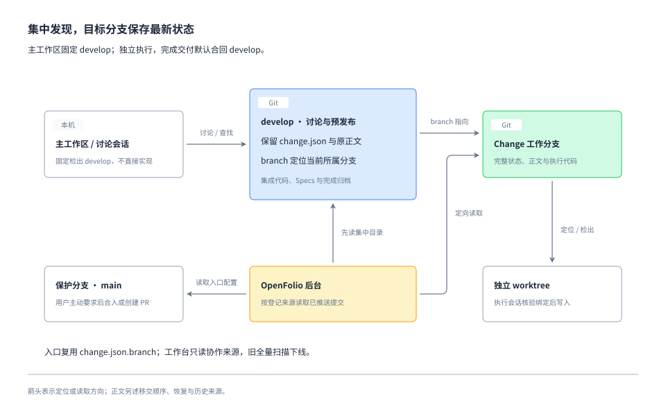

# 集中入口、工作区与读取来源方案

## 方案导读

依据 [Requirement](requirement.md)，采用“develop 集中规划与预发布集成 + branch 定位 + 独立执行”的来源协议。沿用现有 `change.json` 格式和 `branch` 字段；后台和本地命令先解析所属分支，再读取该分支的完整记录。工作台只保留这一路径，旧的全分支扫描下线。

以下契约与命令名称为本次设计提案。客户端工具存在不等于自动流转已经接通；可验证的能力和待实测项见 [Research](research.md)。



图采用文档内嵌架构视图，省略移交中断和原型保留来源，具体规则以下文为准。

## 1. 分支与持久化契约

### 配置入口

`WorkflowConfig` 升为 `schemaVersion: 2`，新增必填 `collaborationBranch`。其余保护分支、原型和 OpenFolio 配置继承现有契约。后台用默认分支上的配置发现仓库和协作分支；找到协作分支后，项目配置和当前材料均从该分支读取。两端 collaborationBranch 须一致，原型策略等项目配置不必等待正式发布。

协作分支默认名为 `develop`，由 Setup 提前登记，兼任预发布集成分支和所有 Change 的默认合入目标，不另设重复的默认目标字段。它与只在用户主动要求时才合入或创建 PR 的保护分支分属两种角色；平台实际保护规则另行核对，不自动撤销保护或绕过所需检查。主工作区固定检出 develop，用于规划、发现和集成协调；产品实现由独立工作分支完成，再把已验收的代码、Specs 与归档合入 develop。

本地 CLI 从当前仓库的 workflow.json 确定协作分支，定向同步后核对集中配置和入口，输出读取提交与新鲜度；不因默认分支仍未发布配置而阻塞 develop 内的开发。离线只允许明确标记的本地阅读和现场恢复，不发布移交或宣称共享状态最新。旧配置的状态命令仅用于接入和既有工作收尾，不能启用后台旧扫描。

### change.json 同时提供分支入口

协作分支保留原有 `change.json`、正文和附件，用 `branch` 判断当前权威来源；移交时不替换格式或删除目录，后续正常归档合码可将目录移入 archive：

| branch 的值 | 协作分支保留内容 | 权威来源 |
| --- | --- | --- |
| 协作分支自身，例如 develop | 原有 change.json、正文和附件 | 该协作分支提交中的完整记录 |
| 工作分支，例如 change/example-change | 同一批文件；branch 改为工作分支，其余内容可保留移交时的版本 | 工作分支上的最新完整记录 |

以下只展示现有 `change.json` 中用于定位的字段，文件仍保留其他完整字段：

```json
{
  "schemaVersion": 1,
  "id": "example-change",
  "branch": "change/example-change"
}
```

读取规则是：先从集中目录的 `change.json` 解析并校验 ID、branch；branch 指向自身时按完整记录处理，指向其他分支时定向读取目标。目标的 `change.json.branch` 必须与实际目标分支一致，不递归追随另一条 branch 形成转发链。

集中副本的 title、stage、status、任务、审批和正文可以保持旧值。目标分支一经登记，当前展示和流程判断都取目标记录；不比较两份记录的新旧时间，不拼接字段，也不因集中副本仍是 requirement 就认定尚未开工。目标不可读时按 ID 报告来源异常，集中副本只供明确标注的历史查阅。

目标分支必须含且仅含该 ID 的一份完整记录：活动/取消读取 `changes/<id>/change.json`，完成读取匹配该 ID 的归档目录；目标分支该 ID 的 live/archive 共存或多份归档均报错。集中副本与目标副本同时存在是正常情况，集中旧正文不参与当前材料收集。执行期间不回写集中状态；归档交付合回 develop 时，集中目录随正常合码成为归档，不另做入口清理提交。其他 Change 的继承副本不参与本 Change 的互斥与关闭判断。

`ChangeState` 保留 `schemaVersion: 1`，不增加入口文件、精简 JSON 格式或额外的移交状态字段。此版本号不代表保留旧工作台扫描路径。提交校验保持完整结构检查，命令和后台先判断记录归属，再对权威记录做阶段、任务及关系的语义校验。集中副本的旧业务字段不影响目标记录的最新状态判断；定位字段非法时报告入口错误，不猜测目标。CLI 的 ID 查重、show、依赖/父子读取及 hook 的原型跨文件检查都遵循归属规则，不能被本分支继承的旧副本阻塞；不在 hook 中增加远端查询。

| 数据 | 共享位置 | 更新时机 |
| --- | --- | --- |
| 后台发现入口 | 默认分支 `workflow.json` 的 collaborationBranch | 接入或入口调整 |
| 当前保护分支约定、原型和服务配置 | 协作分支 workflow.json；本地 CLI 读取当前工作树副本 | 接入或配置调整 |
| 规划阶段完整状态与正文 | 协作分支 Change 目录 | 规划检查点 |
| 工作分支入口 | 协作分支原有 `change.json.branch` | 移交时随规划交付登记，或显式修复分支指向 |
| 移交后完整状态、正文和代码 | 目标工作分支 | 每个执行/返工/关闭检查点 |
| worktree 路径与会话信息 | Git worktree 登记、宿主已有会话能力 | 本机定位与核验；不另建登记库 |
| 预发布 Specs、当前原型入口、集成代码 | 协作分支 develop | 已完成 Change 默认合入 |
| 正式交付代码与文档 | 配置中的保护分支，如 main | 用户主动要求后合入或创建 PR |

## 2. 规划、移交与恢复

### 集中规划

`create` 在协作分支创建完整记录；规划命令允许多个 Change 共存，禁止在该分支进入普通 Change 的产品实现。规划阶段取消仅冻结对应记录。xlarge 父项可继续留在协作分支聚合子项、核对与关闭，不因此开放产品实现；子项独立移交。

共享主工作区允许不同 Change 的文档修改；发布使用限定本 Change 路径的 `git commit --only -- <paths>`，由 Git 的临时 index 隔离其他暂存改动，现有状态锁继续保护 JSON 操作。提交前核对目标文件和 HEAD，禁止顺手 add -A、stash/reset/rebase。不同会话不能同时修改同一 Change；这种情况须协调写入者，路径提交不提供同文件内容锁。移交和集成在独立 worktree 中准备，主工作区有脏文件时不自动同步。无需新增规划锁或要求所有正文先在工作区外编辑。

多机器通过普通快进推送协调。推送拒绝后读取新的集中分支，在隔离临时工作区重新应用自己的文档提交，复核后重试；不 force push，不重写已发布历史，不在共享主工作区直接重排别人尚未提交的工作。

### 权威移交协议

提供一个可重复执行的 `handoff`，支持 dry-run；通过 Git 已有提交与远端入口恢复，不建立本机恢复日志或三段式命令。命令明确展示两处分支的拟推送内容；既有状态命令不因此变成自动提交命令。

1. **核对输入**：读取已推送的 develop 规划提交，核对阶段确认、依赖及完整目录。未推送规划先发布。此步骤不写 execution 状态。
2. **准备登记提交**：从最新且满足依赖的 develop 在独立工作分支/worktree 中准备一个只改本 Change branch 的提交，保留真实审批、任务及其他 Change 的继承副本。该提交同时作为工作分支起点和集中入口登记检查点，不在两端重复提交同一次修改。
3. **先发布目标**：校验并推送登记提交到工作分支，核对远端实际提交。此时远端 develop 仍指向原规划，目标尚未登记，不允许实现。
4. **发布集中入口**：将同一登记提交普通快进推送到 develop。若其他 Change 并发推进而拒绝推送，则在独立 worktree 中合入新的 develop，验证只保留本次登记和已有规划，再先推目标、后推进 develop。本 Change 的规划或归属发生变化时报告差异并重新核对，不覆盖、不强推；不能自动证明一致时保留现场。
5. **验证切换**：重新解析远端集中入口与目标，确认唯一来源；再完成工作区和会话核对，通过现有 execution 前置后进入实现。审批未改变可以继承，移交本身不新增审批。

第 4 步成功推送是权威切换点。两个分支分别发布但共用登记提交，不增加格式替换、目录清理、镜像状态或重复 branch 修改提交。协议不声称两次推送构成事务；发布顺序与共同登记基线让每个阶段都有确定读法，并避免重复登记造成归档 modify/delete 冲突。

| 中断位置 | 对外读取 | 恢复方式 |
| --- | --- | --- |
| 工作分支尚未发布 | 集中完整记录 | 保留本机现场，重新核验后继续准备；失败不切换入口 |
| 目标已发布，集中 branch 仍指向自身 | 集中完整记录 | 从目标与 develop 的提交差异核对登记提交，补发集中分支；不把目标识别为第二主来源 |
| branch 登记推送被拒绝 | 读取当前远端 change.json.branch | 仅其他 Change 变化可合入后重试；本 Change 有变化先核对；已指向同一目标则验证后视为已完成 |
| branch 登记已发布，但确认响应丢失或会话未创建 | 目标分支完整记录 | 从远端 branch 恢复，只做缺失的本机准备，不重复移交 |
| branch 合法但目标已删或记录损坏 | 来源异常 | 保留集中副本与现场，按证据恢复目标或显式修复 branch；不退回集中旧状态 |

两个操作者同时准备同一 ID 时，分支快进检查与入口复核使后完成者看到既有归属，不再切换另一个目标。两端已推送提交足以判断已完成步骤；无法证明对应关系的候选只报告，不猜选。

## 3. 工作区与会话流转

### 确定性的定位顺序

建议提供只读 `locate`，输出仓库身份、配置/入口提交、权威分支与提交、记录位置、本地 worktree 候选、领先落后/脏状态和下一步原因。任何 shell/状态写入均使用明确工作区，不依赖此前一条命令的 `cd`。

1. 通过当前 checkout 的 Git common-dir 识别同一仓库；从配置找到协作分支，而不是猜某个父目录为主工作区。
2. 从已同步的入口解析工作分支；未移交的规划继续交给协作工作区。
3. 读取 `git worktree list --porcelain`，精确匹配 `refs/heads/<branch>`，核对实际路径、仓库 common-dir 和分支。路径已失效、分支被占用、detached HEAD 均单独处理，不自动 prune 或强制检出。
4. 没有本地 worktree 时从已核验目标分支创建。已有本地领先提交或脏文件时保留现场；落后且干净可快进；分叉停止自动同步并提供差异。远端删除不能被残留 tracking ref 掩盖。
5. 依赖安装、忽略文件与运行环境按项目约定准备。凭据只在本机按现有配置来源注入，不提交、打印或整目录盲目复制。各 Change 的测试服务使用独立端口和必要的数据目录；发布长期服务另走项目服务规则。

绑定 worktree 的会话仍可通过共享 Git 信息感知协作分支与其他 worktree；这是同仓库定位能力，不承诺应用 UI 自动展示“主工作区”，也不意味着沙箱或远端权限无限。

### 执行会话协议

客户端适配先查询项目与已有会话，再选择“继续已有绑定会话”或“创建新会话”。主会话保留在协作工作区进行讨论和导航；实现写入由目标会话负责。消息发送、新会话和 worktree 创建遵守宿主工具的实际授权要求，不能由普通仓库文本替用户授予权限。

续接提示包含仓库身份、Change ID、权威分支、工作区路径、预期提交，以及先读取规则/状态/正文并报告 cwd 和分支的要求。提示不复制一份任务进度当权威。绑定核对以目标会话的实际执行结果为准，不能仅凭请求参数或创建请求成功判断。

当前 Codex 工具契约的约束：

- `create_thread` 支持已登记项目的 local 或新建 worktree，但没有“任意既有 worktree 路径”参数。已有工作区只能通过可匹配的项目/会话能力复用，或用户在该目录打开新会话。
- worktree 创建可能异步返回 `clientThreadId`；必须等到真实 threadId 和工作区可核验，才能继续发送。创建时的基线选择也不代表已检出 Change 的命名分支。
- `handoff_thread` 只能迁移其他会话，目标运行会被中断。不能把本会话或子 Agent 自迁移当成可靠流程；没有文档化能力时不尝试绕过。

这些限制不阻塞文档移交和工作区定位。不能自动绑定时提供明确路径、分支和续接提示，等待用户打开后在目标会话验证；主会话不以“所有命令都加 `--repo`”代替已承诺的执行会话绑定。

复用 Git 已有的单分支 worktree 占用检查，locate 提示已有路径；宿主可查询会话时优先继续已有执行会话，不另建本机会话登记或占用协议。同一个 worktree 手动打开多个写入会话不能被 Git 拦截，必须协调唯一执行者；本方案不承诺强制会话互斥或跨机器排他。

## 4. 后台定向读取与缓存

### 来源收集

新模式中 `GitReader` 的输入是显式来源清单，不再用所有 remote heads 作为文档目录：

1. 取得远端 HEAD 与默认分支，读取固定提交上的 `workflow.json`，校验版本、守护分支与协作分支。
2. 定向获取协作分支，读取其项目配置与 changes/archive 中的 `change.json`。有效 completed 归档直接收集完整历史；live branch 指向协作分支自身时收集完整记录与正文，指向工作分支时只提取定位信息形成目标分支集合，不加载集中旧正文和进度。非法入口保持可见。
3. 按名称查询并获取目标 refs，在固定提交上仅读取相应 ID 的 live 或 archive 目录及所引用附件。一个分支可能对应多个登记的 ID，但不能借此扫描全部 Change 副本。
4. 工作台的项目 Specs、项目当前原型及其他当前项目文档均读取协作分支，展示实际分支与预发布属性。默认分支仅用于入口配置，不再并列收集其项目正文。固定原型按已知 Change ID 获取必要保留标签/提交，继续支持已有固定版本；不为了找 Change 枚举所有保留标签。
5. 每个来源在本次解析到的固定 commit 上读取完整状态和正文，不拼接同一来源的不同版本。发布前核对配置与集中路由是否仍一致；路由改变时有界重试。普通目标新提交交给下次刷新，不要求所有并行分支同时静止；快照记录各来源实际 commit 和时间，不承诺跨分支事务快照。

精确查询的 branch/ref 参数使用验证后的完整名称与独立 argv，保持现有 Git 环境隔离、凭据、大小限制和路径检查。严格匹配返回 ref，不能把同名前缀、tag 或残留本地 ref 视为目标。

仓库接入探测也分两步：先从默认分支读取配置，再查询配置中确切的保护/协作 refs。所有工作台读取路径均不使用 `refs/heads/*`，删除原来的全量扫描实现。配置缺失或旧配置未登记协作分支时显示待 Setup 接入，不再展示旧扫描结果为当前状态，也不自动猜测 develop 存在。

### 快照与增量

快照来源清单至少保存：配置版本和提交、协作分支提交、入口内容指纹、每个目标的完整 ref 与 commit、ID 到目录的解析结果，以及必要原型来源。提升读取 fingerprint，不能重用旧全分支来源语义下的快照。

每次刷新都查询已登记目标的当前 refs，即使协作分支未变；来源集合和提交都未变才复用整体快照。单目标提交变化只重新收集其相关目录，继续按 blob SHA 去重。集中 Change 新增、branch 改向、入口删除、远端删除和强制更新都使相关缓存失效；新快照中没有的来源不能通过缓存重新出现。

保留现有原子快照替换：网络或全局限制失败时不覆盖上次成功快照。可确定的单条入口/记录错误进入新快照的来源异常列表；不能因一条错误静默丢掉全部正常 Change，也不能在错误条目中展示旧阶段为当前状态。旧快照可继续阅读，但要标明它的时间与本次读取失败。

限制按实际登记来源数、实际收集文档数与去重字节计算；无关分支数不消耗 v2 来源额度。大量显式登记的来源仍可能超限，保持明确诊断。缓存 Git 配置从宽泛 fetch 改成受控精确获取时须迁移或重建这一可重建缓存，不影响用户登录、密钥和偏好。

## 5. 索引、关系与原型的一致来源

`indexChanges` 接收由集中 `change.json.branch` 解析的路由，按 ID 生成唯一权威候选及入口依据，删除全分支候选推断。目标记录非法时保留诊断，不寻找“更正常”的其他分支副本。目标记录声明分支不匹配、同目标重复归档等不可判定；集中副本与目标状态不同属于预期情况，不报归属冲突。集中目录自身同 ID 的 live/archive 冲突需修正正常合码结果，不能任选其一；不同工作分支中的继承副本不构成集中入口重复。

工作台沿用列表、详情和来源异常界面，补充集中入口与实际权威记录的来源区别。业务状态和当前文档只从权威分支读；异常入口可用 ID 阅读错误，不能将集中副本的旧阶段或任务当成当前值。文档 ID/来源链接继续基于实际来源，集中副本不重复计为业务 Change。

依赖、父子关系和执行条件使用同一 ID 路由。前置归档关闭与所需代码已集成仍分别验证；祖先关系或归档存在都不证明实现未被回滚。xlarge 父项可在协作分支，其子项可在多个工作分支，不复制子项状态。

项目当前原型与 Specs 跟随 develop，工作台不另建 main/develop 双版本视图；保护分支发布情况不能从预发布文档推断。Change 固定原型跟随该 Change 权威记录，保留标签只是产物/历史来源，不能覆盖有效入口的最新执行状态。读取权限、公开固定版本和已有分享地址语义不变。相关 Specs 为 [Change 追踪](../../specs/project-knowledge/change-tracking/spec.md)、[文档阅读](../../specs/project-knowledge/spec-reading/spec.md)和[原型浏览](../../specs/project-knowledge/prototype-preview/spec.md)。

## 6. 取消、返工、归档与分支保留

- **移交前取消**：完整记录留在协作分支，仅该 Change 冻结；其他规划继续。
- **移交后取消/返工**：在目标工作分支更新，集中副本不回写状态、不迁回集中分支；取消按现行规则冻结目标分支。
- **执行归档**：目标分支按既有四步关闭并移动完整目录，集中入口在合码前仍通过 branch 定位目标归档。交付默认合入 develop，代码、Specs、归档及原目录删除随同一正常合码进入，不另行同步状态或维护指针。
- **规划父项归档**：无产品实现的 xlarge 父项可在协作分支关闭归档；后台读取其集中归档，仍不向主工作区开放普通执行写入。
- **合入后的归档**：统一按 develop 中有效的 completed 归档直接读取，只读归档已是完整终态，branch 保留原工作分支归属；不要求旧归档重建分支，也不新增迁移标记。合入前集中 live 入口仍严格追随目标，目标缺失或损坏不得通过旧副本兜底。归档例外仅适用于实际合入且通过完整关闭校验的归档，不据集中副本的旧 status 猜测已完成。
- **清理**：不自动删除远端工作分支。按用户指令清理前核对完整交付已进入 develop，且不存在仍依赖该分支的活动或取消入口；本地 worktree 另核对干净、已推送和无活跃会话。合入后的有效归档可独立阅读，避免为保留历史无限查询所有已结束工作分支。

这意味着定向读取仍与已登记未集成交付的工作分支数相关，不承诺常数成本；收益是排除无关分支和集中旧正文的重复读取，不需要同步维护两份执行状态。

### 默认集成与保护分支发布

Change 达到已有验收和关闭条件后默认合入 develop，不重复询问合入目标；该默认规则不替代阶段确认、验收或实质冲突的处理。合码校验聚焦本次交付及目标集成结果，允许其他 Change 的规划目录留在 develop 和源分支中。不能继续要求“整个源提交不含任何 live Change”。并发完成的 Change 依次集成并验证冲突；依赖已关闭且交付进入 develop 后，下游即可同步推进。

在工作分支的独立 worktree 内合入最新 origin/develop，验证后将结果普通快进推送到 develop，不 squash；拒绝时重新同步并核对。主工作区仅在干净时快进，不在共享讨论现场处理合码冲突。迁移旧工作分支缺少共同登记基线时，本次合码明确解决该 ID 的 live/archive 冲突，保留目标归档和其他 Change，不能用全局目录清理解决。

只有用户主动要求时，才准备保护分支的合入或 PR。默认发布单位是一个已验证 develop 提交的完整交付树，过滤 docs/project/changes/ 后在保护分支上准备单父提交或 PR 分支，明确源与目标提交及完整差异；不把过滤提交合回 develop。保护分支有独立修改时先核对并回流所需修改，不能用树投影覆盖热修复。热修复优先在 develop 完成；不整体将保护分支发布历史合回 develop，避免传播规划目录删除。部分 Change 发布不是本次自动化范围，用户另有明确要求时单独评估依赖和具体候选。本次只调整规则，不建设发布引擎或持久化发布登记。已有明确指令继续执行，不重复索取同一授权。

## 7. Setup、接入与旧扫描下线

Setup 在创建 Change 前引导确认实际默认分支、协作/预发布分支（默认 develop）、保护分支和平台权限规则，持久化 collaborationBranch，说明所有 Change 默认合入协作分支、保护分支只接受用户主动要求的交付。已有 develop 先检查现有用途和内容，缺失时由 Agent 在接入授权内从已核对的基线准备，不能覆盖同名分支。核对主工作区现场后再固定检出；检查器保持只读，配置就绪与 hook 已接通仍分别验证。用户的本次命名要求不等于现在立即切换正在使用的主工作区。

升级后的工作台只支持集中来源读取，不维护 v1 全量扫描兼容路径。未配置 collaborationBranch 的旧项目返回可操作的待接入提示；新版配置不被旧工具理解时必须拒绝写入。ChangeState 的既有结构和历史文档保持可读，不借下线扫描批量改写状态。

接入提供 dry-run 清单，来源为 develop 基线、已知 Change 清单、本地已登记 worktree 与显式提供的工作分支；不为迁移保留旧全分支正文扫描引擎。逐项检查活动/取消记录、归属冲突、历史归档、原型引用和拟登记 branch。已有执行 Change 原分支不动，将其现有完整 `change.json` 副本放入集中目录并保留目标 branch，后续不镜像更新；不生成另一种入口格式。规划 Change 搬到协作分支时核对真实确认和未发布现场。接入报告列出覆盖依据与未解决项，不能声称自动发现所有未知分支的 Change。

切换顺序：准备支持集中读取的工具/后台 → 准备 develop 及已知 Change 入口 → 核对各 branch 可读 → 发布入口配置 → 启用新读取并核对工作台 → 干净时将主工作区固定到 develop。配置入口仍在默认分支；当它同时是保护分支时，配置发布也遵守用户主动要求的合入/PR 规则。Setup 明示这项前置；尚未授权发布配置时保留具体差异和演练结果，不借“接入”绕过保护分支边界。普通 Change 合入 develop 不触发这项发布。

接入失败保留原 Git 内容和未提交现场，列明缺失项后继续修复，不自动全量扫描或创建第二套状态。新版本读取缓存提升 fingerprint，旧扫描快照不充当新模式的成功结果；已有集中来源成功快照的临时刷新失败可按原约定展示过期数据。回滚程序版本不等于流程记录可以直接降级，已产生集中规划后需先证明旧工具能正确读取再另行处理。接入不删除工作分支、不批量修改归档，不重置运行数据。

本仓库 `.agents/skills/spec-trail/` 合入 main 后继续由现有 GitHub Actions 自动分发；默认集成 develop 不自动触发正式分发。实现涉及服务时按 AGENTS 的停止、构建、启动、验证顺序更新长期开发验证服务，使用已验证 develop 提交的干净专用 checkout，避免构建占用共享规划工作区。生产构建与服务切换串行，保留现有登录和工作台数据。

本 Change 继续使用当前可用的状态命令完成验证与关闭，不依赖尚未实现的移交命令来启动自身。T6 先在隔离克隆演练 develop 准备、配置发布和来源接入；真实交付默认进入准备好的 develop，不因自举自动合入 main。真实主工作区与后台切换须满足配置发布前置及当时实际授权。发布/切换结果保存在普通 Git 与运行证据中，不为补记结果改写已归档 Change。演练通过不表述为真实主工作区已启用新模式。

## 8. 验证路径与关键取舍

采用临时 bare remote 与多个克隆/worktree 验证协议，注入目标推送失败、branch 并发更新、响应丢失、分叉和来源删除。记录实际 Git argv 证明 v2 未全量发现；以固定 fixture 验证集中副本停留在旧阶段、仅目标变化的增量刷新与重复归档去重。校验器、CLI 与后台必须共享配置与 branch 定位规则，避免三套相近定义。

会话流转由 Agent 按当前宿主实际能力执行，通用 CLI 负责定位、准备与续接提示。当前已核对到项目/会话查询工具，创建和 Handoff 工具不在本轮可调用列表中，因此交付人工打开路径并明确能力限制。后续宿主提供创建接口时再核验实际绑定；不能用 mock 或命令的工作目录代替宿主能力结论。

关键选择为：develop 同时承担规划和预发布集成；入口只复用 change.json.branch；独立执行后默认合回 develop，保护分支操作由用户主动要求；必要分支发布可恢复，不做格式替换和目录清理提交；新会话优先于迁移当前会话；工作台只展示协作来源，删除旧扫描兼容路径。各项验证和交付边界见 [Plan](plan.md)。
