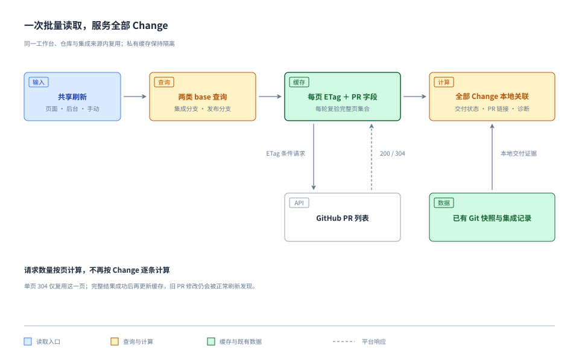

# PR 批量查询与页面缓存

本方案落实 [需求](./requirement.md)：在正常读取路径减少重复请求，限流仍报错。核心改动只有三项：按目标分支批量读取 PR、按页面复用 ETag 缓存、在 GitHub 请求入口记录已发生限流的冷却时间。

## 查询组织

将逐 Change 的网络查询改为每个仓库来源的两个批量查询：以实际集成分支为 base 读取 Change PR，以实际发布分支为 base 读取发布 PR。不存在对应分支时沿用来源未就绪诊断；相同规范化查询只执行一次。

固定请求为 `pulls?state=all&base=<branch>&sort=created&direction=desc&per_page=100&page=<n>`。沿用 PR 接口使用的 `2022-11-28` API 版本，以保留既有合并提交字段；不改其他 GitHub 接口的版本。

按 base 依次完成分页，复用同一轮的查询结果；不为列表增加并发任务池。两个查询取得完整页面集合后，在本地按 PR 编号去重，解析 SpecTrail 标记，并建立 Change id、来源分支和发布 includes 的查找表。继续使用现有仓库身份、目标分支、来源分支、有效集成记录及 Git 祖先关系判定交付。列表已包含所需字段，删除这条交付链路中的逐 PR 详情、逐 Change head 查询与 commit 回查；来源分支删除后，合并 PR 仍由 `state=all` 列表提供。

缓存保存所有同仓库、具有合法 SpecTrail 标记的 PR，不能只保存当前 Change 列表命中的条目。这样新增 Change、集成记录或发布分支提交变化时，可以直接重新计算关联。无关联 PR 是完整查询结果的本地结论，不再单独维护每个 Change 的空结果缓存。

图只展示查询与交付计算的关系；冷却及错误处理见后文。

## 页面复验与历史复用

每页缓存 ETag、GitHub 原始条数、是否存在下一页，以及必要的 PR 摘要和解析后的标记。正文只用于解析标记，不在缓存里保存整段 PR body；分页原始条数不能用过滤后的 PR 数量替代。

| 响应 | 页面处理 |
| --- | --- |
| 200 | 校验并规范化本页，替换该页内容和 ETag；没有 ETag 时，下轮正常 GET。 |
| 304 | 复用发送该 ETag 时对应的完整页面内容；若响应提供分页信息则采用新信息，否则保留本页已知信息。 |
| 错误或数据不完整 | 本查询失败，不用错误生成空页，不提交半份结果。 |

每轮从第一页开始复验所有所需页面。某页 304 只证明该页未变，不能据此跳过历史页。页面有 next，或 GitHub 原始条数恰好为 100 时，继续下一页；非满页且没有 next 才结束。满页后的下一页允许为空。这一统一结束条件覆盖旧 PR 改 base 后进入末尾，而之前满页 304 没有新 Link 的情况。

排序固定为 created desc：编辑旧 PR 的正文或状态不会因更新时间改变排序位置；新增 PR、改变 base 等实际改变集合的行为由正常分页读取发现。所有页完成后，用本轮集合替换该 base 的完整结果，移除失去标记或离开该 base 的旧关联，删除不再需要的尾页。两种 base 查询各自完整才算成功，不把另一类查询的局部失败伪装成自己的失败。

历史 PR 仍按原有刷新节奏复验，没有额外 TTL、冷热分层、终态永久冻结或周期补扫。手动刷新同样使用条件请求，不清空缓存或绕过冷却。分页是 GitHub 的普通最终一致读取，不能描述成远端原子快照；跨页期间发生变更时，由下一次正常刷新反映，不增加补查循环。

## 请求量与资源边界

设两种 base 的 PR 数为 P₁、P₂，常规满页分页时，一轮请求数为 `floor(P₁ / 100) + 1 + floor(P₂ / 100) + 1`；整百时包含用于确认结束的空尾页。相同查询只计一次。请求数取决于列表页数，不再取决于 Change 数和历史关联消费者数。

当两种 base 各不足 100 个 PR 时，一轮为 2 次请求。对照已有离线输入，原算法每轮 83／73 次调用可缩为两种查询各一页；这是相同模拟数据下的算法比较，不是对远端实际 PR 总数的测量。历史 PR 增加到需要新页面时仍会增加分页请求，不承诺历史无限增长时请求数恒定。

正确认证的 304 不消耗主额度，但仍有网络与二级限流成本。减少网络请求来自批量查询，节省重复响应和主额度来自页面缓存；两项分别验证。依据见 [GitHub 缓存最佳实践](https://docs.github.com/en/rest/using-the-rest-api/best-practices-for-using-the-rest-api#use-conditional-requests)。

原先“每个 Change 查询最多十页”不适用于更宽的 base 查询，不能照搬成每个仓库最多 1000 个 PR。移除该页数帽，分页仍受现有单轮 `refreshMs`（默认 120 秒）和单响应 8 MiB 限制；复用 `limits.totalBytes`（默认 64 MiB）作为单份规范化 PR 缓存大小上限，不新增配置。超时、超量或分页错误直接报告未完成，不截断为成功、不续传、不切回逐 Change 查询。

## 缓存归属与发布

在现有仓库来源目录中新增一份 `pull-requests.json`，继续按工作台、稳定仓库身份和集成来源隔离。文件只保存内部格式版本、查询参数，以及各查询最近完整页面集合；无需新增数据库、后台任务或持久化 PR 索引，查找表每轮从页面集合派生。

缓存查询身份包含 base、固定排序、每页条数和 PR API 版本。工作流改变发布分支时，新查询正常初始化，旧查询退出本来源缓存。缓存文件缺失时进行首次查询；已存在但损坏时明确报告缓存错误，不自动忽略或覆盖。每个 ETag 必须与同一请求参数下的完整本页数据一起保存。

复用现有来源刷新合并、写入锁、权限检查和原子文件替换。某个 base 分页中途失败时保留该查询之前的完整缓存；另一查询完整成功时可更新自身结果。缓存写入和快照发布遵循现有凭据任务的有效性检查，不发布失效绑定的数据。进程重启后可直接用已保存页面发条件请求。

既有 Snapshot 与 Workbench 格式、账号和绑定数据不变，不提升快照版本，不迁移或删除已有资料。新页面缓存不从旧交付摘要反推，因为旧摘要没有完整分页、标记与 ETag，不能冒充完整查询结果。

## 统一冷却与错误

GitHub 适配器的唯一请求入口增加进程共享的冷却表，键为受信平台实例和 GitHub subject id；它只存最早允许再次请求的时间，不存 Token、仓库数据、剩余额度预算或任务队列。两个工作台使用同一 GitHub 身份时共享冷却，内容和权限结论仍隔离。

普通仓库读取、发现、权限复验和已知身份的重新认证均传入已有身份。首次绑定一个尚未识别身份的 Token 时，只执行识别身份所必需的 `/user` 请求；无法在知道身份前凭空归入用户级冷却。失败直接报错，不为此增加 Token 指纹注册表或额外身份探测。

请求前检查冷却；未到期就返回 `RATE_LIMITED` 和剩余等待时间，不发 HTTP 请求。请求返回限流时，优先采用有效 `Retry-After`；主额度耗尽时同时遵守 `x-ratelimit-reset`，两个有效期限取更晚者。二级限流通过状态码及受限读取的错误正文识别，不能仅依赖 remaining 为零，也不能把它归类为 `READ_DENIED`。

没有可信恢复时间时，报告“恢复时间未知”；二级限流按 GitHub 文档至少等待一分钟，表达为最早重试时间而非平台恢复承诺。不新增自动重试或指数重试循环。到期后仅允许正常调用继续，失败仍报错。冷却表不持久化，服务重启后从实际响应重新建立，避免引入第二份运行状态存储。

首次限流向上抛出，不再在逐 Change 循环中消化后继续查询；所有尚未发出的同身份请求都会在统一入口被拒绝，已在途请求可以结束。刷新接口明确返回限流，保留原内容快照和对应成功时间，后台按现有方式记录错误，不积压补发。网络错误及 PR 权限错误沿用既有局部诊断规则；仅完整成功的查询更新其结果，不能用缓存把本轮失败标记为成功。授权失效仍走原有撤销路径。

浏览器 API 错误保留服务端给出的等待信息，用于现有错误提示；冷却正确性由服务端保证，不新增客户端调度器、倒计时页面或管理界面。

## 取舍与简化

| 处理 | 依据与结果 |
| --- | --- |
| 保留 | Git 身份、PR 标记、有效集成与祖先关系决定交付语义；来源权限隔离决定数据能否交付。 |
| 合并 | 把逐 Change、逐 PR 的获取合并为两类 base 分页；同页只有一份缓存，正负关联结果由本地集合派生。 |
| 删除 | 交付链路中的逐条详情请求、重复 head/commit 搜索，以及不再合适的单查询十页帽。 |
| 不采用 | updated_at 水位早停、历史 TTL 分层、永久冻结、ETag 之外的第二套变化检测；它们增加状态和失效规则，当前批量方案已能显著减少请求。 |
| 延后 | Webhook、GraphQL、额度预测、动态限频和独立监控能力，均不属于本次已确认范围。 |

不需要新的凭据权限、外部服务或 UI 原型；部署仍使用现有单实例与持久目录。缓存是新增可重建数据，本方案没有业务数据不兼容升级。

## 验证路径

围绕请求计数和实际行为验证，不编写镜像实现的测试：

- 用相同 PR 集合分别加入少量和大量引用它们的 Change，批量请求次数相同；冷热两轮分别核算 HTTP 请求、200 与 304，保留旧算法的 83／73 次基线作对比。
- 验证 0、100、101、1001 条原始 PR 的分页，页面全部无标记仍正确计数；首页 304 而历史页发生正文修改、标记删除、关闭或重开时仍更新。
- 验证旧 PR 改 base 后移出旧集合并进入新集合、来源分支删除后的合并记录、发布 includes 修改及 Git 祖先关系变化，确保交付判定保持原有含义。
- 验证后一页失败或超限不发布半份缓存，不产生新的无 PR 结论；另一类查询成功仍保留其已验证事实。重启、相同来源并发刷新和不同工作台隔离沿用现有测试边界。
- 验证明确限流后同身份其他入口不再发请求，主限额 reset 与二级限流正确区分，恢复时间未知不虚报；无新增重试，冷却后失败仍报错，失败不延长成功时间。

技术阶段已完成八组离线分页实验，结果及适用范围见 [调查记录](./research.md#技术方案离线验证)。实施阶段再将上述场景接入现有 Provider、交付采集和后台刷新测试，完成类型检查、生产构建及服务更新后的针对性冒烟。
