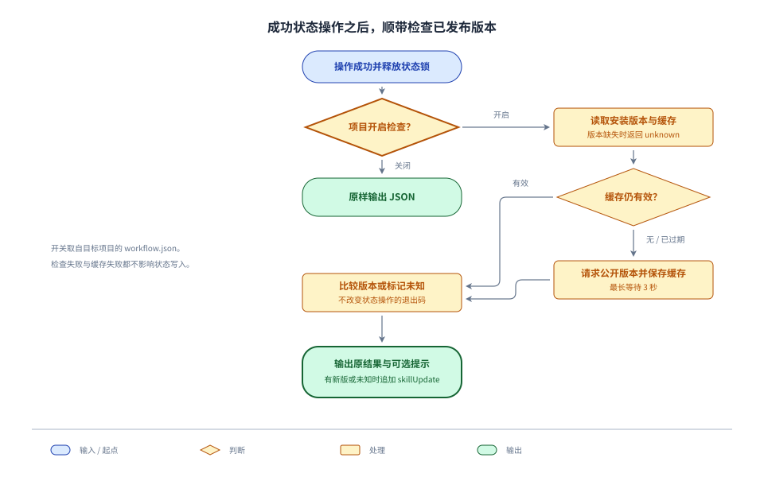

# SpecTrail 版本标识与更新检查技术方案

## 目标与实现依据

依据 [Requirement](requirement.md)，在现有发布链路生成安装版本，仅在项目日常使用的 `change.mjs` 检查新版，通过可关闭的项目配置控制。最小交付是：有内容变化才递增版本，有新版才提醒，关闭后不检查，检查异常不改变状态操作结果。

已核实现状：

- `scripts/sync-spec-trail.sh` 已从固定源提交导出 skill，通过 `rsync --delete` 同步到分发目录，以 Git 工作树差异判断是否发布，并在同一提交中推送交付内容；分发目录的 LICENSE 单独保留。现有 CI 已串行执行该脚本，无需增加独立工作流。
- `change.mjs` 已从当前目录或 `--repo` 定位 Git 工作区，读取其 `docs/project/workflow.json`，并在写操作结束时释放仓库锁。成功输出包括 show、dry-run 和普通状态操作几个分支，需要在 CLI 层统一收口。
- skill 的 `validateWorkflow` 与 OpenFolio 的 `workflowCoreSchema`、`workflowSchema` 都拒绝未知字段，需要同步接受新增可选开关。现有配置不需要迁移或升级 schemaVersion。
- 2026-10-23 读取[公开分发树](https://github.com/iTgo-lyq/spec-trail/tree/96f26e0dfa0d233274f95f4c29dc53ffe304984d/skills/spec-trail)，确认尚无版本文件；本机 Node v24.21.0 使用内置 fetch 无认证读取公开 SKILL.md，返回 HTTP 200，耗时约 2.5 秒。这证明当前环境可访问公开来源，不代表所有使用方网络均可用。skill 继续使用 Node.js 20+ 和内置模块。

## 发布版本

发布物在 skill 根目录携带 `version.json`，首版为：

```json
{ "version": "0.1.0" }
```

它由同步脚本写入分发仓库 `skills/spec-trail/version.json`，不回写 OpenFolio 源分支。版本文件就是发布计数来源，不另建计数器、tag 或 Release。源提交追溯继续使用现有发布提交消息，不在元数据中重复保存 SHA、时间戳或内容哈希。

发布流程复用当前同步机制：

1. 在修改分发目录前读取其已发布版本。缺少版本文件表示首次接入；已有文件但格式非法则停止发布，不把损坏数据重置成首版。
2. 导出固定源提交并同步正文、脚本和资源。保留分发 LICENSE 与生成的 `version.json`，将它们排除在 skill 内容变化判断之外；过期普通文件仍由 rsync 删除。源目录不维护生成版本文件。
3. 无版本时为现有内容建立 `0.1.0` 基线；有版本且内容无变化时直接结束，不修改版本文件，不提交或推送。
4. 有版本且内容变化时只增加补丁号，例如 `0.1.9 → 0.1.10`。首期不从提交标题猜测重大或次要版本升级。
5. 将版本文件和导出的全部 skill 内容一起验证、提交、推送。现有分发测试继续运行；新增更新检查模块的自包含测试也纳入发布验证。

版本语法限定为不带前导零、预发布和构建后缀的 `major.minor.patch`，按三个非负整数比较，不引入 semver 依赖。第一次引入版本文件本身需要产生一次基线发布。版本格式读取、补丁递增与比较由内置模块实现的公共小模块复用，供发布脚本和更新检查使用。

发布失败以远端分发仓库中最后成功推送的版本为准。测试失败不提交，推送失败不改写远端；后续 CI 从最新分发 main 重新计算。现有串行发布策略保留，重复运行成功发布不会再递增。未推送的 CI 临时目录不作为下一次版本基线。

## 项目配置

在现有 workflow v3 增加可选布尔字段 `checkForUpdates`：

```json
{
  "schemaVersion": 3,
  "integrationBranch": "develop",
  "releaseBranch": "main",
  "checkForUpdates": false
}
```

省略或 true 为开启，false 为关闭；字符串、null 等其他类型继续报配置错误。skill 的字段声明、共享校验器和 OpenFolio 两个配置 schema 使用相同规则。工作台只接受并读取该字段，不执行更新检查，不增加 UI 开关。

开关始终取自实际目标工作区的本地 workflow.json。显式 `--repo` 优先，否则从当前目录确定 Git 根目录；全局安装的 skill 也读取目标项目配置。关闭判断先于读取缓存、联网或写缓存，因此关闭后没有更新提示。关闭只影响更新检查，不改变状态命令原有的协作分支读取行为。

新版本接受旧配置；需要关闭检查的项目在采用新字段前，先更新其使用的 skill 和 OpenFolio 配置读取实现。旧版读取器严格拒绝新字段的行为保持不变，不增加双版本协议或自动配置迁移。

## 检查入口与输出



唯一接入点是 `change.mjs` 的 CLI 成功输出层。内部状态操作返回原结果及私有仓库上下文，CLI 在操作完成、finally 释放状态锁之后执行检查，最后只输出一次 JSON。更新信息附加在结果外层，不写入 `state`、Change 正文或其他流程记录。

show 和正常状态操作采用同一路径。help、无效参数、原操作失败和 dry-run 不执行检查；dry-run 继续作为无副作用的预览，不读写更新缓存或等待网络。原操作失败时维持既有 stderr 和退出码，不用更新提示遮盖失败原因。

本地版本相对正在执行的脚本模块定位到 skill 根目录读取，不从目标项目中猜测安装目录，也不使用项目 HEAD 冒充已安装版本。最新版只从以下固定公开地址读取：

`https://raw.githubusercontent.com/iTgo-lyq/spec-trail/main/skills/spec-trail/version.json`

使用内置 fetch，无 Token，不读取用户凭据，不发送项目地址、工作区路径或 Change 内容；禁止重定向，不增加可配置下载地址。请求与响应体读取共用 3 秒超时，响应最多 16 KiB，非 2xx、无效 JSON 或非法版本都按检查未知处理。安装版本缺失或非法时无需联网，直接说明版本未知。

输出契约：

| 情况 | 原 JSON 外层的更新字段 |
| --- | --- |
| 关闭、预览、最新版等于或低于本地版本 | 省略 `skillUpdate` |
| 确认有新版 | `skillUpdate: { status: "available", currentVersion, latestVersion, message }` |
| 安装版本缺失、网络异常、版本数据不可比较 | `skillUpdate: { status: "unknown", currentVersion?, message }` |

例如：

```json
{
  "command": "task-start",
  "state": { "id": "example" },
  "skillUpdate": {
    "status": "available",
    "currentVersion": "0.1.0",
    "latestVersion": "0.1.1",
    "message": "SpecTrail 有新版本 0.1.1，当前安装为 0.1.0。"
  }
}
```

示例省略原命令的其他字段；实现保留它们的原值。message 由本地模板与已校验的版本号生成，不直接透传远端文本。没有更新时结果形状保持原样；发现更新或未知情况也不修改原退出码。检查辅助模块内部处理异常，避免状态已经写成功后因提示失败把命令报告为失败。

## 本地缓存与失败处理

缓存放在目标仓库 `git-common-dir/spec-trail/update-check.json`，复用已获取的 Git common-dir，支持普通仓库与 worktree，不要求项目额外配置 .gitignore。开关仍按各工作区分别读取；关闭的工作区不会因为共享缓存而显示提示。

缓存只保存检查时间及已验证的最新版本，或本次检查失败的标记，成功和失败结果均复用 24 小时；它不保存当前安装版本。每次调用都读取实际安装版本，与缓存的最新版本比较，因此手动升级 skill 后不沿用旧的可更新结论。缓存年龄为负、格式无效或已过期时视为未命中，后续执行一次有时限的请求。

写缓存采用同目录临时文件加 rename，沿用已有脚本的原子替换方式。缓存损坏、目录不可写、写入失败只影响缓存复用，仍可输出本次检查结果；不持有状态锁等待网络，不另增更新检查锁或常驻进程。多个命令同时冷启动可能重复请求，但不影响流程数据或输出语义，无需增加跨进程调度。

检查失败时输出 unknown，不使用过期的可更新结论，也不把未知当成已是最新。原状态操作的结果和退出码保持不变；检查缓存丢弃后可重建，不备份或迁移。

## 接入与验证路径

官方分发安装第一次手动更新后，版本文件与检查逻辑同时可用。没有检查代码的旧安装不会凭空获得检查能力；从 OpenFolio 源目录直接使用的开发副本没有发布版本时，报告 unknown，不伪造版本或联网猜测。接入说明使用现有 skill 文档位置，明确关闭配置、提示含义与旧安装首次更新方式。

本次无需新的外部服务或凭据。发布继续复用现有同步 CI 的 SSH key；其权限是否足以完成新发布，仍以实际发布运行结果为准，不在开发验证阶段向公开仓库发布测试版本。OpenFolio 配置 schema 的改动会随实现正常构建、集成并更新长期服务；在需求和技术阶段不改运行实现或重启服务。

| 验证范围 | 验证方法与预期结果 |
| --- | --- |
| 发布版本与内容一致 | 扩展现有 `tests/skill-sync.test.ts` 的本地 Git 源仓库、分发仓库和 bare remote：首次基线、内容修改递增、重复发布不变、无关源提交不变；删除旧文件、保留 LICENSE 和其他 skill；验证失败不发布，非法已有版本不重置。 |
| 开关与配置一致 | 扩展 routing、prototype-contract 与 skill setup 测试：缺省、true、false 在 CLI 和工作台均接受，非布尔值拒绝；关闭时更新 HTTP 请求计数为零。 |
| 单入口与输出 | 扩展状态命令测试，使用隔离项目、安装副本和可控 fetch：从子目录或 --repo 读取正确配置；新版可解析且只增加外层字段，show 走相同路径，原失败与 dry-run 不触发检查。 |
| 缓存与异常 | 对检查辅助模块注入时间、fetch 等局部依赖：命中不重复请求、过期重查、手动升级后重新比较；超时、非 2xx、非法响应、缺版本、损坏/只读缓存均不影响原操作；两个项目开关独立，worktree 共享缓存不绕过开关。 |
| 实现整体 | 运行变更相关测试、skill 自包含测试与类型检查；OpenFolio 配置接入的构建和服务更新按仓库约定串行进行，部署后选择配置读取冒烟。独立评审与人工验收按 medium Change 执行，不用一次网络成功代替行为验收。 |

以上是实施后的验证安排。本轮实际证据只有本地代码、测试结构、公开分发树与一次原生 HTTP 只读探测，尚未实现或验证新增行为。

## 冗余审查

| 处理 | 机制与依据 | 最小方案 |
| --- | --- | --- |
| 保留 | 内容变化判定保护重复发布不加版本；开关、超时和缓存保护日常命令可用性；配置双侧校验保护工作台正常读取。 | 复用已有 Git diff 与发布串行，仅新增版本文件、一个布尔配置和一个检查辅助模块。 |
| 合并 | 版本发布和检查需用同一版本语法，所有成功状态输出需遵守同一提示行为。 | 公共小模块处理版本，change CLI 层统一收口，不逐脚本接入。 |
| 延后 | 自动安装、固定版本、重大/次要版本推断超出当前检查目标。 | 本次只提示已发布新版，不引入更新代理或安装管理器。 |
| 建议删除 | 独立发布工作流、额外计数器/哈希索引、每次命令重复联网及跨进程更新锁均没有本次必须保护的新不变量。 | 使用现有分发提交、已有 diff 和可重建缓存，容许少量并发冷请求。 |

两个模块分别评估配图：发布是单一路径，用有序说明足够；检查存在关闭、缓存和网络分支，用上图表达。图中将缺版本和网络异常合并到未知结果，具体语义以上文契约为准。
