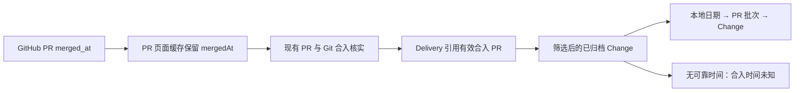

# 归档合入时间线方案

需求见 [requirement.md](requirement.md)。本次复用已有交付采集、目录筛选与详情导航，只补足合入时间证据和呈现。

## 数据与证据

已核实本地实现：GitHub provider 已验证响应的 merged_at，但映射 PullRequest 时只保留 updatedAt；PullRequestCache 会按 schema 筛掉未声明字段。collectDelivery 已逐个核对发布 PR 的合并提交属于发布分支、且包含对应 Change 的集成提交。目录当前按创建时间排序，已结束行展示 closure.archive.at。

在 PullRequest 增加可选 mergedAt（ISO 时间或 null），从已校验的 merged_at 原样映射，并让 PR 页面缓存保留它。新增字段不改变旧数据可读性。给 provider 的 PR 缓存身份增加映射版本，使下一次正常刷新获取新字段，避免旧 ETag 页面永久缺失时间；不改 GitHub HTTP API 版本、不删除用户数据，也不另建缓存系统。

在 Delivery 增加可选 releaseMergedPrNumber，引用 releasePrs 中通过现有 Git 核实且拥有有效 mergedAt 的 PR。若多条满足，按合并时间升序、PR 编号升序选择第一条，代表最早可核实的合入批次。前端不依据 state=merged 自行认定发布分支合入。历史 deliveryOverride 继续决定展示资格，但只有实际通过上述证据核实的 PR 才提供时间；缺少集成证据或可靠 PR 时留空，不让补记生成证据。

复用现有缓存、刷新和失效提示。旧快照缺字段时仍可读，展示未知时间，成功刷新后自然补齐；采集失败不把缓存中的未核实候选变成新证据。已有过期提示仍须可见。

## 界面与交互

仅在目录查询唯一状态为 archived、且非来源异常时启用时间线。沿用现有过滤器先得到结果，再用独立纯函数按有效 PR 的 mergedAt 分组；日期采用浏览器本地时区，与当前日期显示保持一致，测试显式固定时区验证跨日边界。日期标题含年份，日内批次按合入时间倒序，批次成员按既有稳定顺序展示。

日期作为时间线节点，批次标题集中呈现版本、实际目标分支、PR 和匹配数量。沿用现有主题变量、系统字体、Badge、Button、标题链接和焦点样式，不引入组件库或动画。每批默认 3 条，按钮显示“展开其余 N 项”/“收起”；未知时间使用同样的紧凑条目。展开状态在详情往返时保留或按返回目标恢复，保证原行可见、焦点可恢复。筛选导致成员变化时按当前匹配数计算折叠。

归档专属视图隐藏不适用的分组、排序、看板选项；保持已有 URL 可读，不改个人视图存储契约。混合状态和其他状态仍走原列表，统一使用新的交付标签映射。跨日期的连续交付关系不将记录从真实日期挪走，详情仍保留关系阅读。

手机将日期和批次标题放在条目上方，长版本、分支、标题允许换行，PR 与展开按钮可键盘访问，展开状态通过 aria-expanded 表达。浅色和深色复用主题，不增加新色板。

## 影响与验证

仅新增可选快照字段，不迁移账号、Token、偏好或历史 Change；不增加新的 GitHub 请求类别。发布分支只读，本 Change 默认交付目标仍为 develop。另一个活动 Change xlarge-parent-integration 涉及交付核实；实施前核对其最新集成情况，保留其已落地规则，仅在同一核实位置收集合入时间。

定向单元测试覆盖 provider 映射、PR 缓存新旧记录、合入候选选择、补记与缺失时间、同日多批次、跨时区日期及筛选计数。浏览器覆盖批次折叠、详情返回、筛选、未知时间、混合视图回归，以及 1440/390/320 宽度和明暗主题。运行类型检查与相关测试；交付构建和真实冒烟遵循主工作区服务约定，不覆盖运行中 .next。

按用户 Q2 不制作独立原型；以现有产品的组件与主题为视觉基线，实施后提供实际界面供验收。

## 复杂度核对

- 保留 PR/Git 核实：防止把关联但未进入目标历史的 PR 误显示为合入日期；直接复用既有判定。
- 合并重复标签映射：列表、详情和分享使用同一套交付文案，避免漂移。
- 不引入部署状态、批量发布操作、独立历史数据库或新视图配置：当前目标只需已有数据增加时间字段并分组展示。
- 不回填归档、不推测历史时间：未知时间是明确且可验证的呈现，不增加迁移或补记流程。
