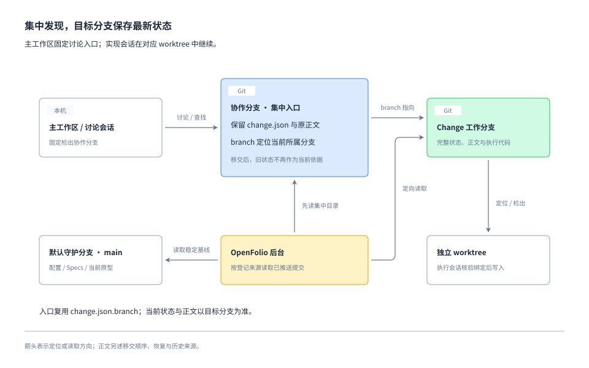

# 集中入口、工作区与读取来源方案

## 方案导读

依据 [Requirement](requirement.md)，采用“集中规划 + branch 定位 + 独立执行”的来源协议。沿用现有 `change.json` 格式和 `branch` 字段；后台和本地命令先解析所属分支，再读取该分支的完整记录。

以下契约与命令名称为本次设计提案。客户端工具存在不等于自动流转已经接通；可验证的能力和待实测项见 [Research](research.md)。



图采用文档内嵌架构视图，省略移交中断、旧模式兼容和原型保留来源，具体规则以下文为准。

## 1. 分支与持久化契约

### 配置入口

建议 `WorkflowConfig` 升为 `schemaVersion: 2`，新增必填 `collaborationBranch`。其余守护分支、原型和 OpenFolio 配置继承现有契约。默认分支上的配置是项目入口；协作分支中的配置副本不能重新定义项目入口。

协作分支使用普通 Git 分支，建议名称 `planning`，由 Setup 显式登记，不硬编码路径或假定等于 `main`。该分支不能是守护分支。主工作区固定检出它，允许提交规划材料、入口记录及必要的基线同步，不承载产品实现。

本地命令从远端默认分支的已获取配置确定协作分支，输出读取提交与新鲜度。离线只允许明确标记的本地阅读和现场恢复，不发布移交或宣称共享状态最新。

### change.json 同时提供分支入口

协作分支始终保留原有 `change.json`、正文和附件，用 `branch` 判断当前权威来源：

| branch 的值 | 协作分支保留内容 | 权威来源 |
| --- | --- | --- |
| 协作分支自身，例如 planning | 原有 change.json、正文和附件 | 该协作分支提交中的完整记录 |
| 工作分支，例如 change/example-change | 同一批文件；branch 改为工作分支，其余内容可保留移交时的版本 | 工作分支上的最新完整记录 |

以下只展示现有 `change.json` 中用于定位的字段，文件仍保留其他完整字段：

```json
{
  "schemaVersion": 1,
  "id": "example-change",
  "branch": "change/example-change"
}
```

读取规则是：先从集中目录的 `change.json` 解析并校验 ID、branch；branch 指向自身时按完整记录处理，指向其他分支时定向读取目标。目标的 `change.json.branch` 必须与实际目标分支一致，不递归追随另一条 branch 形成转发链。

集中副本的 title、stage、status、任务、审批和正文可以保持旧值。目标分支一经登记，当前展示和流程判断都取目标记录；不比较两份记录的新旧时间，不拼接字段，也不因集中副本仍是 requirement 就认定尚未开工。目标不可读时按 ID 报告来源异常，集中副本只供明确标注的历史查阅。

目标分支必须含且仅含该 ID 的一份完整记录：活动/取消读取 `changes/<id>/change.json`，完成读取匹配该 ID 的归档目录；目标分支 live/archive 共存或多份归档均报错。集中副本与目标副本同时存在是正常情况，集中旧正文不参与当前材料收集。普通任务完成、取消和归档不要求清理集中目录，也不回写其状态。

`ChangeState` 保留 `schemaVersion: 1`，不增加入口文件、精简 JSON 格式或额外的移交状态字段。提交校验保持完整结构检查，命令和后台先判断记录归属，再对权威记录做阶段、任务及关系的语义校验。集中副本的旧业务字段不影响目标记录的最新状态判断；定位字段非法时报告入口错误，不猜测目标。

| 数据 | 共享位置 | 更新时机 |
| --- | --- | --- |
| 项目入口、守护分支、原型配置 | 默认分支 `workflow.json` | 接入或配置调整 |
| 规划阶段完整状态与正文 | 协作分支 Change 目录 | 规划检查点 |
| 工作分支入口 | 协作分支原有 `change.json.branch` | 移交时随规划交付登记，或显式修复分支指向 |
| 移交后完整状态、正文和代码 | 目标工作分支 | 每个执行/返工/关闭检查点 |
| worktree 路径、host、会话 ID、写入占用、移交恢复日志 | 本机 Git common-dir 下的运行信息 | 本机准备、绑定与恢复；不提交 |
| 稳定 Specs、当前原型入口、交付代码 | 默认守护分支 | 独立交付合入 |

## 2. 规划、移交与恢复

### 集中规划

`create` 在协作分支创建完整记录；规划命令允许多个 Change 共存，禁止在该分支进入普通 Change 的产品实现。规划阶段取消仅冻结对应记录。xlarge 父项可继续留在协作分支聚合子项、核对与关闭，不因此开放产品实现；子项独立移交。

共享主工作区的写入必须串行。先在工作区外准备正文，再取得本机规划发布锁，核对预期 HEAD、目标文件原文与暂存区，应用本次修改，执行语义命令、校验、限定路径提交和推送，最后释放锁。存在无法归属的已暂存或未提交修改时不得自动 stash/reset/rebase。现有 JSON 原子写锁继续使用，但不能冒充覆盖 Markdown 与 Git index 的完整临界区。

多机器通过普通快进推送协调。推送拒绝后读取新的集中分支，在隔离临时工作区重新应用自己的文档提交，复核后重试；不 force push，不重写已发布历史，不在共享主工作区直接重排别人尚未提交的工作。

### 权威移交协议

提供语义移交入口，建议分为 `handoff-prepare`、`handoff-publish` 与 `handoff-recover`；准确命令接口在实现时与既有 CLI 保持一致。新命令明确展示两处分支的拟提交/推送内容，支持 dry-run；既有状态命令不因此变成自动提交命令。

1. **冻结本次输入**：读取已推送的集中规划提交，核对阶段确认、依赖及完整目录。保存预期协作分支 HEAD、本 Change 目录 tree ID、拟用工作分支与基线提交到本机恢复日志。未推送规划必须先发布。此步骤不写 execution 状态。
2. **准备工作分支**：从最新且满足依赖的守护分支创建工作分支；只带入本 Change 目录，通过专用语义操作修改 `branch`，保留真实审批和任务。若迁移既有工作分支则核验并复用，不重建或覆盖。
3. **先发布目标**：校验、提交并推送完整目录到工作分支；核对远端实际提交。此时集中记录的 branch 仍指向协作分支自身，目标是尚未登记的准备结果，不允许实现。
4. **登记工作分支**：通过语义命令更新集中 `change.json.branch`，保留 JSON 其他字段与原有正文。将登记并入规划交付检查点，发布前比较原 Change tree 与准备输入，确认目标已发布并与这份输入对应；按预期远端 HEAD 普通快进推送。其他 Change 更新只需重读并重放本次 branch 修改；本 Change 更新则重新准备目标，不丢弃新增讨论。禁止强推解决冲突。
5. **验证切换**：重新解析远端集中入口与目标，确认唯一来源；再完成工作区和会话核对，通过现有 execution 前置后进入实现。审批未改变可以继承，移交本身不新增审批。

第 4 步的 branch 修改成功推送是权威切换点。两个分支的必要发布仍要分别核对，但不增加为改用引用格式、清空集中目录或镜像执行状态而产生的提交。协议不声称两次远端推送构成事务；依靠发布顺序、目录指纹校验和可重试恢复，让每个已发布阶段都有确定读法。

| 中断位置 | 对外读取 | 恢复方式 |
| --- | --- | --- |
| 工作分支尚未发布 | 集中完整记录 | 保留本机现场，重新核验后继续准备；失败不切换入口 |
| 目标已发布，集中 branch 仍指向自身 | 集中完整记录 | 核对两端与本机日志，补发 branch 登记；不把目标副本识别为第二主来源 |
| branch 登记推送被拒绝 | 读取当前远端 change.json.branch | 仅其他 Change 变化可重放；本 Change 有变化则重做准备；已指向同一目标则验证后视为已完成 |
| branch 登记已发布，但确认响应丢失或会话未创建 | 目标分支完整记录 | 从远端 branch 恢复，只做缺失的本机准备，不重复移交 |
| branch 合法但目标已删或记录损坏 | 来源异常 | 保留集中副本与现场，按证据恢复目标或显式修复 branch；不退回集中旧状态 |

两个操作者同时准备同一 ID 时，集中目录指纹与分支快进检查必须使后完成者看到既有入口；不再发布另一个目标。没有本机日志也能从两端已推送内容判断已完成步骤；有无法证明对应关系的候选时只报告，不猜选。

## 3. 工作区与会话流转

### 确定性的定位顺序

建议提供只读 `locate`，输出仓库身份、配置/入口提交、权威分支与提交、记录位置、本地 worktree 候选、领先落后/脏状态和下一步原因。任何 shell/状态写入均使用明确工作区，不依赖此前一条命令的 `cd`。

1. 通过当前 checkout 的 Git common-dir 识别同一仓库；从配置找到协作分支，而不是猜某个父目录为主工作区。
2. 从已同步的入口解析工作分支；未移交的规划继续交给协作工作区。
3. 读取 `git worktree list --porcelain`，精确匹配 `refs/heads/<branch>`，核对实际路径、仓库 common-dir 和分支。路径已失效、分支被占用、detached HEAD 均单独处理，不自动 prune 或强制检出。
4. 没有本地 worktree 时从已核验目标分支创建。已有本地领先提交或脏文件时保留现场；落后且干净可快进；分叉停止自动同步并提供差异。远端删除不能被残留 tracking ref 掩盖。
5. 依赖安装、忽略文件与运行环境按项目约定准备。凭据只在本机按现有配置来源注入，不提交、打印或整目录盲目复制。各 Change 的测试服务使用独立端口和必要的数据目录；发布长期服务另走项目服务规则。

绑定 worktree 的会话仍可通过共享 Git 信息感知协作分支与其他 worktree；这是同仓库定位能力，不承诺应用 UI 自动展示“主工作区”，也不意味着沙箱或远端权限无限。

### 执行会话协议

客户端适配先查询项目与已有会话，再选择“继续已有绑定会话”或“创建新会话”。主会话保留在协作工作区进行讨论和导航；实现写入由目标会话负责。消息发送、新会话和 worktree 创建遵守宿主工具的实际授权要求，不能由普通仓库文本替用户授予权限。

续接提示包含仓库身份、Change ID、权威分支、工作区路径、预期提交，以及先读取规则/状态/正文并报告 cwd 和分支的要求。提示不复制一份任务进度当权威。绑定核对以目标会话的实际执行结果为准，不能仅凭请求参数或创建请求成功判断。

当前 Codex 工具契约的约束：

- `create_thread` 支持已登记项目的 local 或新建 worktree，但没有“任意既有 worktree 路径”参数。已有工作区只能通过可匹配的项目/会话能力复用，或用户在该目录打开新会话。
- worktree 创建可能异步返回 `clientThreadId`；必须等到真实 threadId 和工作区可核验，才能继续发送。创建时的基线选择也不代表已检出 Change 的命名分支。
- `handoff_thread` 只能迁移其他会话，目标运行会被中断。不能把本会话或子 Agent 自迁移当成可靠流程；没有文档化能力时不尝试绕过。

这些限制不阻塞文档移交和工作区定位。不能自动绑定时提供明确路径、分支和续接提示，等待用户打开后在目标会话验证；主会话不以“所有命令都加 `--repo`”代替已承诺的执行会话绑定。

同机每个 Change 的执行写入使用本机占用记录，键包含仓库与 ID，记录 host、会话、进程/实例 token 和 worktree；获取原子化，开始写入前核对所有者。陈旧占用须核实原会话已停止和现场后接管，不能只按文件年龄删除。只读会话不抢占。该机制不提供跨机器全局互斥；多人仍须协调同一 Change 的执行者，远端推送冲突明确暴露。

## 4. 后台定向读取与缓存

### 来源收集

新模式中 `GitReader` 的输入是显式来源清单，不再用所有 remote heads 作为文档目录：

1. 取得远端 HEAD 与默认分支，读取固定提交上的 `workflow.json`，校验版本、守护分支与协作分支。
2. 定向获取协作分支，读取各 Change 的 `change.json` 以及在此关闭的规划父项归档。branch 指向协作分支自身时收集完整记录与正文；指向工作分支时只提取定位信息，形成去重后的目标分支集合，不加载集中旧正文和进度。非法 branch 以诊断保留。同步 main 带来的归档副本不算集中规划主记录。
3. 按名称查询并获取目标 refs，在固定提交上仅读取相应 ID 的 live 或 archive 目录及所引用附件。一个分支可能对应多个登记的 ID，但不能借此扫描全部 Change 副本。
4. 默认分支只读取稳定 Specs、配置、项目当前原型及既有历史归档。固定原型按已知 Change ID 获取必要保留标签/提交；不再为了找 Change 枚举所有保留标签。
5. 发布前重新核对默认配置、协作入口与所用目标 refs 是否变化。变化时有界重试；持续变化或传输失败保留旧快照并标明刷新失败，不发布混合来源结果。

精确查询的 branch/ref 参数使用验证后的完整名称与独立 argv，保持现有 Git 环境隔离、凭据、大小限制和路径检查。严格匹配返回 ref，不能把同名前缀、tag 或残留本地 ref 视为目标。

仓库接入探测也分两步：先从默认分支判断配置版本，再查询配置中确切的守护/协作 refs。v2 正常发现路径不使用 `refs/heads/*`。v1 保留原兼容读取路径，错误的 v2 不能降级成 v1。

### 快照与增量

快照来源清单至少保存：配置版本和提交、协作分支提交、入口内容指纹、每个目标的完整 ref 与 commit、ID 到目录的解析结果，以及必要原型来源。提升读取 fingerprint，不能重用旧全分支来源语义下的快照。

每次刷新都查询已登记目标的当前 refs，即使协作分支未变；来源集合和提交都未变才复用整体快照。单目标提交变化只重新收集其相关目录，继续按 blob SHA 去重。集中 Change 新增、branch 改向、入口删除、远端删除和强制更新都使相关缓存失效；新快照中没有的来源不能通过缓存重新出现。

保留现有原子快照替换：网络或全局限制失败时不覆盖上次成功快照。可确定的单条入口/记录错误进入新快照的来源异常列表；不能因一条错误静默丢掉全部正常 Change，也不能在错误条目中展示旧阶段为当前状态。旧快照可继续阅读，但要标明它的时间与本次读取失败。

限制按实际登记来源数、实际收集文档数与去重字节计算；无关分支数不消耗 v2 来源额度。大量显式登记的来源仍可能超限，保持明确诊断。缓存 Git 配置从宽泛 fetch 改成受控精确获取时须迁移或重建这一可重建缓存，不影响用户登录、密钥和偏好。

## 5. 索引、关系与原型的一致来源

`indexChanges` 在 v2 接收由集中 `change.json.branch` 解析的路由，按 ID 生成唯一权威候选及入口依据。目标记录非法时保留诊断，不寻找“更正常”的其他分支副本。目标记录声明分支不匹配、同目标重复归档等不可判定；集中副本与目标状态不同属于预期情况，不报归属冲突。

工作台沿用列表、详情和来源异常界面，补充集中入口与实际权威记录的来源区别。业务状态和当前文档只从权威分支读；异常入口可用 ID 阅读错误，不能将集中副本的旧阶段或任务当成当前值。文档 ID/来源链接继续基于实际来源，集中副本不重复计为业务 Change。

依赖、父子关系和执行条件使用同一 ID 路由。前置归档关闭与所需代码已集成仍分别验证；祖先关系或归档存在都不证明实现未被回滚。xlarge 父项可在协作分支，其子项可在多个工作分支，不复制子项状态。

项目当前原型与 Specs 保持默认守护分支来源；Change 固定原型跟随该 Change 权威记录，保留标签只是产物/历史来源，不能覆盖有效入口的最新执行状态。读取权限、公开固定版本和已有分享地址语义不变。相关 Specs 为 [Change 追踪](../../specs/project-knowledge/change-tracking/spec.md)、[文档阅读](../../specs/project-knowledge/spec-reading/spec.md)和[原型浏览](../../specs/project-knowledge/prototype-preview/spec.md)。

## 6. 取消、返工、归档与分支保留

- **移交前取消**：完整记录留在协作分支，仅该 Change 冻结；其他规划继续。
- **移交后取消/返工**：在目标工作分支更新，集中副本不回写状态、不迁回集中分支；取消按现行规则冻结目标分支。
- **执行归档**：目标分支按既有四步关闭并移动完整目录，集中 `change.json.branch` 不变，原有集中目录也无需清理；读者按 ID 在目标找到其唯一归档。集中旧目录不参与目标 live/archive 互斥检查。工作分支独立合入 `main`，协作分支不整体参与合码。
- **规划父项归档**：无产品实现的 xlarge 父项可在协作分支关闭归档；后台读取其集中归档，仍不向主工作区开放普通执行写入。
- **历史副本**：默认分支归档与已登记入口同 ID 时，入口定义当前来源，默认分支副本只作交付历史，不计第二个 Change。没有集中入口的既有归档从默认分支读取，须通过有效完成校验；其旧 `branch` 保留为历史归属，不能伪称仍是可写目标。
- **清理**：本方案保留新 Change 的远端工作分支，避免入口断链；不自动删除已合入分支。清理本地 worktree 要核对干净、已推送和无活跃会话。未来如需转移归档存储，可另设计 branch 改向；本次不依赖此能力。

这意味着定向读取仍与已登记工作分支数相关，不承诺常数成本；收益是排除无关分支和集中旧正文的重复读取，不需要同步维护两份执行状态。

## 7. 接入、兼容与回退

先交付能识别 v1/v2 配置的共享校验、命令和后台，再启用 v2。v1 项目明确沿用旧语义，新 Setup 引导使用 v2；旧工具拒绝不支持的配置版本，不能忽略 branch 归属继续写入集中副本。

迁移工具提供 dry-run 清单：现有活动/取消记录、归属冲突、历史归档、原型引用、拟登记 branch 和本地工作区。仅显式迁移可做一次旧全分支盘点；常规刷新不保留兜底扫描。已有执行 Change 原分支不动，将其现有完整 `change.json` 副本放入集中目录并保留目标 branch，后续不镜像更新；不生成另一种入口格式。规划 Change 搬到协作分支时须核对真实确认和未发布现场，不将冲突副本自动合并。完成迁移需核对所有已知活动/取消工作已登记或有明确处理结论。

切换顺序：发布支持新协议的工具/后台 → 准备并推送协作分支及 Change 记录 → 验证各 branch 指向可读 → 在默认分支发布 v2 配置 → 验证新读取 → 干净时将主工作区固定到协作分支。通过正常合码完成配置切换；不先修改现行 `main`。协作分支定期在串行维护窗口同步默认基线，核对目录冲突后提交，不整体合回默认分支。

切换前失败可停留在 v1；切换后已经产生集中规划时，不得只把版本号改回 v1。必须冻结写入、导出可读的完整记录与分支归属、验证旧读法再显式回退；否则保留 v2 并修复。迁移不删除工作分支、不批量修改归档，不重置运行数据。

本仓库 `.agents/skills/spec-trail/` 合入 main 后继续由现有 GitHub Actions 自动分发。实现涉及服务时按 AGENTS 的停止、构建、启动、验证顺序更新长期服务；部署来源选择已验证的交付 checkout，不能默认从协作分支打包。生产构建与服务切换串行，保留现有登录和工作台数据。

本 Change 自身沿 v1 完成实现、验证、归档与合入，避免为了交付新协议而提前用未发布协议管理自己。T6 先在隔离克隆完成本仓库迁移演练与接入检查；真实主工作区切换属于工具与后台发布后的接入操作，届时按实际授权执行。发布/切换结果保存在普通 Git 与运行证据中，不为补记结果改写已归档 Change。演练通过不表述为主工作区已经启用新模式。

## 8. 验证路径与关键取舍

采用临时 bare remote 与多个克隆/worktree 验证协议，注入目标推送失败、branch 并发更新、响应丢失、分叉和来源删除。记录实际 Git argv 证明 v2 未全量发现；以固定 fixture 验证集中副本停留在旧阶段、仅目标变化的增量刷新与重复归档去重。校验器、CLI 与后台必须共享配置与 branch 定位规则，避免三套相近定义。

会话适配通过可控假客户端覆盖异步与错误绑定，并在当前 Codex 客户端验证可用的创建/继续路径；无法自动连接已有 worktree 时演示人工打开降级。验收要求真实 cwd 证据，不能用 mock 代替客户端能力结论。

关键选择为：复用 change.json.branch 并保留集中原文件；必要分支发布可恢复，不做格式替换和目录清理提交；新会话优先于迁移当前会话；远端分支保留取代立即引入归档重定位；v2 严格定向读取、v1 显式兼容。各项验证和交付边界见 [Plan](plan.md)。
