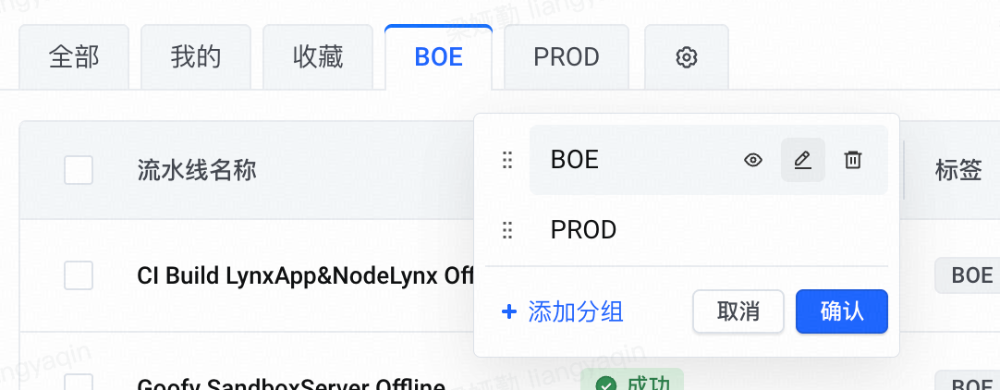

# Changes 动态视图与已发布归档

将一次性的默认本人筛选升级为可保存、切换和管理的动态视图。用户首次进入即可看到“我的”视图，之后可按自己的关注方式添加视图。已经发布、通常无需继续跟进的 Change 自动进入独立的“已归档”页签，减少日常列表干扰。

## 用户已明确的范围

- 提供 Change 动态视图能力，默认给用户添加“我的”视图。
- 仅参考用户截图的交互：横向视图 tab，末尾齿轮打开管理弹层；保留 OpenFolio 现有视觉样式。
- 创建、编辑视图时暴露状态筛选：进行中、已取消、已归档、已完成；支持多选。
- 添加视图时默认采用当前使用的筛选与显示选项。
- 已确认发布的 Change 自动进入“已归档”；“已完成”保留待集成、待发布和交付待核实记录。
- “已取消”数量为 0 时不展示该 tab。
- 历史详情、材料、合入与发布依据仍可访问，既有详情链接继续有效。

动态视图保存查询条件及显示方式，每次基于当前可读数据计算结果，不保存一份静态 Change 名单。“已归档”页签按交付结果分类，不新增 SpecTrail 流程状态、不改写已完成归档或删除历史记录。

## 改动边界

本次界面改动限于 Changes 的 tab 区域、视图管理弹层及必要的筛选/显示联动；服务端视图保存与状态分类只服务于上述已确认能力。整页原型的侧栏、顶栏、表格/卡片、详情和其他模块仅作上下文，不能作为整体改版的实施依据。沿用正式产品现有组件和布局，不照搬原型其他区域、不调整全局主题或顺带重构其他页面。验证需确认范围外区域保持既有行为与样式。

## 视图入口与管理

参考用户提供的交互：视图横向排列成 tab，末尾放齿轮按钮，点击打开管理弹层。初始默认选中“我的”，保留进行中、已完成、已归档以及有记录时的已取消快捷入口，系统状态 tab 固定在前，顺序为进行中、已完成、已归档、已取消（数量为 0 时隐藏）；个人视图（含默认“我的”）排在右侧，按管理器中保存的顺序展示。初始默认选中“我的”不因位置改变。管理入口标为“管理视图”，与已有“筛选”“显示”区分。窄屏横向滚动 tab，管理入口保持可达。

参考图仅用于交互参考，不照搬页签外形、配色、尺寸或整体样式；沿用 OpenFolio 现有紧凑分段页签和工具栏。图中的 BOE、PROD、收藏及流水线内容不作为新增业务功能。

管理弹层的个人视图行显示名称，左侧拖拽柄用于排序，右侧提供显隐、编辑、删除操作；底部左侧“添加视图”，右侧“取消 / 确认”。图标须有可识别名称，触屏及键盘可访问，并提供不依赖拖拽的排序方式。排序仅作用于右侧个人视图，不能移动或穿插左侧系统状态 tab。

点击添加时复制当前筛选和显示选项进入编辑表单，可修改名称、状态及其他条件。编辑已有视图时载入其保存的配置，不能被当前页面的临时筛选覆盖。添加、编辑、删除、排序和显隐统一暂存在管理草稿中，点击“确认”成功保存后更新 tab；“取消”或关闭弹层丢弃本次管理修改。保存失败保留草稿并允许重试，不能显示为已保存。

隐藏视图保留配置，可再次显示；删除视图不删除 Change。隐藏或删除当前视图后回到可见的“我的”，否则回到进行中。系统状态快捷入口固定，不重命名或删除；默认“我的”仅首次初始化时添加，作为可管理的个人视图，用户删除后不自动重建。首次初始化之外不重置用户保存的顺序、显隐或筛选。

系统默认视图（含初始“我的”及固定状态入口）的自带筛选条件不重复显示在列表标签区，也不计入工具栏筛选角标；没有额外条件时不保留空白标签行。额外添加的条件仍显示且可移除，自定义视图仍展示其条件。筛选面板和视图编辑表单保留完整条件，自带条件继续参与查询。

## 保存内容与动态身份

每个视图保存以下条件与显示选项：

- 状态：进行中、已取消、已归档、已完成，在创建及编辑表单中直接可见。支持多选，同一状态组内取并集，与创建者等其他筛选取交集；未限制状态时包含全部四类。添加时继承当前状态选择，从固定状态入口添加则默认选中该状态；可以直接修改或清除，不必先切换 tab。
- 其他筛选：创建者、类型（含无类型）、紧急程度。
- 显示：列表或看板、按处理状态/阶段/不分组、最新创建或紧急程度优先排序。

不把正在打开的 Change、文档、章节、滚动位置或临时错误页面保存为视图条件。看板继续只支持仅选进行中的视图；包含其他状态、未限制状态或窄屏时采用列表降级，不因此覆盖用户保存的显示偏好。

“我的”初始条件为进行中、创建者为本人，其余沿用默认显示选项。“本人”是动态条件，使用当前选用 Token 的 GitHub 身份，与 Change 首次 Git 提交作者的可识别平台身份对应；不能固化成初始化时的用户名，也不能用 OpenFolio 登录名或同名作者猜测身份。其他显式指定创建者继续作为固定作者条件。

无本人记录时提示“暂无你创建的 Change”并提供调整筛选或查看进行中的入口；历史作者无法可靠识别时说明识别边界，不把这些记录误归给其他用户。视图不会扩大账号或 Token 的仓库权限。

## 保存与下次进入

个人视图与最近选中的视图按 OpenFolio 账号、稳定仓库身份保存到服务端，同账号重新进入或换浏览器后可恢复；不同账号互相隔离，Token 切换后以当前可读数据和当前 GitHub 身份重新计算。不同仓库各自保存视图。

主列表临时调整采用显式保存：调整筛选或显示立即作用于当前列表，并标明视图有未保存修改；点击“保存到当前视图”才覆盖已有定义，也可用“添加视图”另存。从固定状态页签调整后可以另存个人视图。切换视图时不自动改写原视图。

刷新及浏览器前进后退按 URL 恢复当次可见查询，包括临时调整；从无筛选的新入口进入时恢复上次选中视图的已保存配置。没有使用记录时默认“我的”。显式查询链接与指定 Change 的深链接优先于个人默认，详情返回保持原视图和当前条件；其他用户打开阅读链接不依赖拥有发送者的个人视图，也不获得其视图管理权限。

## 已归档与已取消

使用现有交付状态的“已发布”判定（releaseMerged，包括有效历史发布补记）自动分类；仅工程文档归档、仅合入 develop 或待发布均不进入已归档。沿用现有发布证据与错误处理，不因单次 PR 查询失败误归档。

已完成与已归档互斥；页签数量、列表过滤、详情前后切换和延续组聚合使用一致的范围判定。更新确认发布后记录自动归入已归档，已有详情仍可继续阅读。

“已取消”是否隐藏按仓库可读记录中的取消总数判断，不因临时创建者或类型筛选恰好无匹配而反复出现/消失。更新后总数变为 0 且正处于该系统页签时回到进行中，保留显式 Change 详情目标；指向已取消的旧链接仍正常解析为空结果或详情。状态筛选中的四个选项始终可选，即使已取消数量为 0；仅隐藏对应系统快捷 tab，不隐藏用户自定义的取消视图。来源异常入口保留。

## 验收场景

1. 首次进入可见并选中“我的”，系统默认视图自带条件不重复展示为筛选标签；返回或重新登录恢复已保存视图，清除筛选不会被默认条件立即覆盖。
2. 设置入口可新增个人视图，完整带入创建者、类型、紧急程度、当前状态选择、列表/看板、分组和排序；创建和编辑均可直接选择四类状态。多选取并集，再与其他条件取交集；未限制状态包含四类，混合状态不误用进行中看板。保存后切换回来得到同样的查询与显示方式，结果随数据更新变化。
3. 按参考图的交互提供管理弹层，个人视图可排序、显隐、重命名、更新和删除；取消不落库，确认成功后统一生效，失败保留草稿。隐藏可恢复、删除不删记录，当前视图不可见时正确回退，默认视图不反复初始化，不影响其他账号或仓库。
4. 临时调整、保存、另存、刷新、详情返回、前进后退和显式链接的行为符合已确认保存规则，不悄悄覆盖其他视图。
5. “本人”跟随当前 GitHub 身份，固定创建者条件保持明确；不能误匹配同名作者，不能因视图恢复扩大读取权限。
6. 已发布仅出现在已归档；待集成、待发布和待核实继续出现在已完成；取消总数为 0 时隐藏对应系统 tab，非零时显示。
7. 分组与延续组、来源异常、无匹配、桌面与窄屏、列表/看板降级以及既有筛选回归通过。

## 规模与准备边界

仍按 medium 管理：需要联动个人视图持久化与恢复、身份条件和查询/显示投影，以及交付范围分类。需求已确认，当前准备技术方案与交互原型；截图只作为交互参考，视觉沿用现有 OpenFolio。截图缓存优化不在此次范围中。

## 澄清

Q1（已答）：已归档是自动收纳已发布 Change，还是由用户手动归档不再关注的记录？用户选择：“已发布后自动进入已归档（推荐）”。

Q2：用户以截图参考横向 tab、末尾齿轮及管理弹层交互，后续明确保留现有样式、不照搬截图外观，弹层包含排序、显隐、编辑、删除、添加和取消/确认。主列表临时修改采用显式保存，随用户后续对完整需求的确认一并确定。

补充：用户要求“进行中、取消、归档、完成”作为创建视图时可见的筛选项目；本稿将其作为状态条件，并支持多选及编辑时调整。
