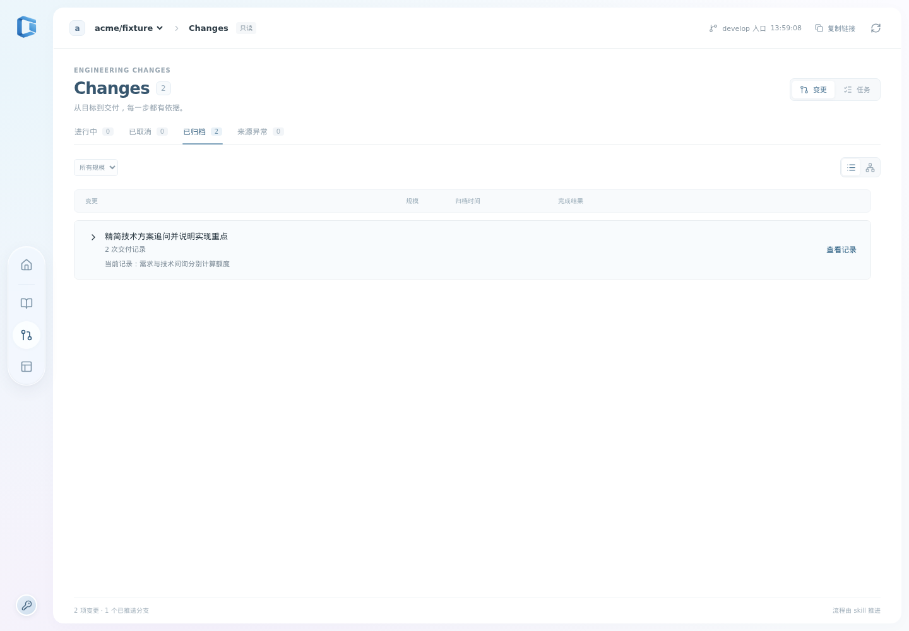
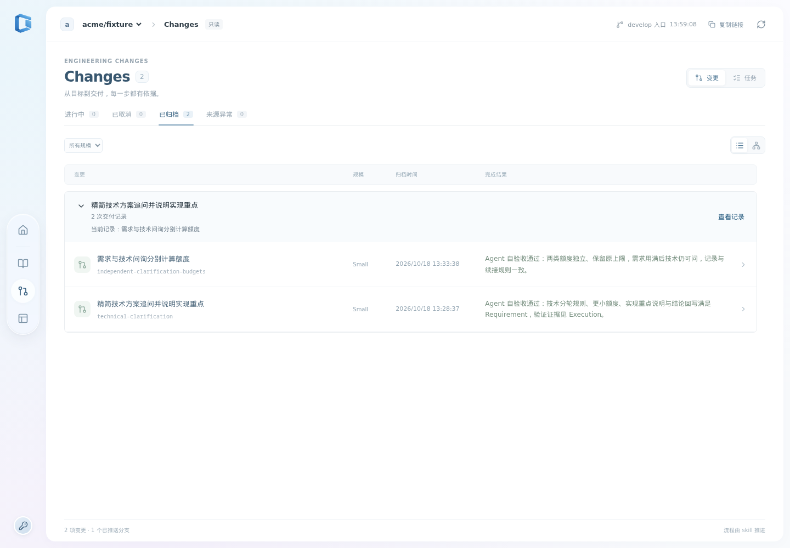
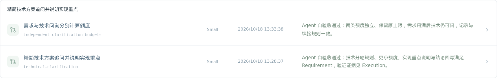
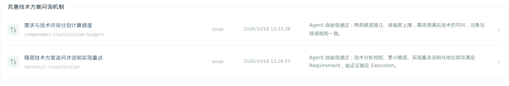
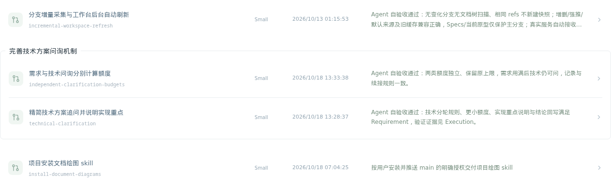

# 实施与验证

## T1：延续关系登记与折叠阅读

交付可选 followUpOf、create / follow-up 命令、列表折叠与详情连续交付上下文；原任务、阶段、执行依赖和每次关闭记录继续独立。筛选先匹配成员，再聚合；已归档入口仍提示本组进行中的调整。关联异常只影响分组，保留单独入口与完成事实。

初轮 `npm test` 224 项通过，Change 与延续关系浏览器回归 14 项通过，类型、格式、skill 校验与生产构建通过。截图核对发现组标题继承全局按钮居中样式，修正为左对齐后复验通过；320px 无横向溢出。独立评审发现的两处边界及修复见 [Review](./review.md)。

开发机环境验证在独立 worktree 完成。Turbopack 不接受跨 worktree 的 node_modules 链接，因此在本 worktree 使用 npm ci 安装依赖；浏览器使用 .next-e2e，生产构建使用 .next。

评审修复后重新运行：`npm test` 224/224；`npx playwright test tests/browser/follow-ups.spec.ts tests/browser/changes.spec.ts` 14/14；`npm run typecheck`、`npm run format:check`、`npm run build`、skill quick_validate 与 `git diff --check` 均通过。浏览器覆盖折叠、键盘、筛选后根不匹配、活跃后继、取消记录、独立详情深链接及刷新、格式错误关联提示与 320px。

## T2：历史关联与实际页面验证

历史迁移提交 `9b4ef2d` 仅在 `2026-10-18-independent-clarification-budgets/change.json` 增加 `followUpOf: technical-clarification`。去掉新行后与迁移前文件逐字节一致；JSON 剩余字段深比较一致，前序归档及全部历史正文无差异。迁移保留两次交付的任务、验收结论和时间。

将这两份真实归档材料及当前 Specs 复制到隔离 Git 远端，经实际 SnapshotStore 读取后，两条记录均 validCompleted，关系解析得到单组且无关联问题。实际应用浏览器读取该快照，验证折叠为一个入口、展开两次交付、逐条打开详情、原 id 深链接和刷新，1 项专门验证通过。此处用隔离快照供验收，长期服务待人工验收后随 develop 集成更新。

独立复审补查出取消子项也必须遵守关闭阶段、步骤和时间顺序；补齐通用关闭语义后，定向关联测试 4/4 通过。

实现分支已合并协作分支 `fedeff1`，无文本冲突；新增协作改动位于原型发布脚本、测试及文档，与延续关系运行逻辑无重叠。针对导入改动运行原型发布测试通过，skill 校验与 diff 检查通过。

## 开发服务验收

用户随后明确要求“启动一下服务我看看实际效果”。按本次开发服务预览授权，将已验证交付提前集成到 develop，从主工作区更新长期服务，供用户查看真实仓库的关联与折叠效果。该操作只推进可运行预览，Change 继续保持 active / close 等待人工验收，不提前记录验收通过、同步 Specs 或归档。

开发服务已从主工作区构建并运行提交 `e3a71a2`，端口 11117，tmux 托管；IPv4 与 IPv6 首页均返回 200。使用 withSmokeSession 登录真实工作台并刷新 develop 快照，验证两条归档仍有效完成、后继字段正确、列表默认折叠为一个含两次交付的组，展开后两条原 id 详情均可打开且显示已归档。真实浏览器与服务端冒烟通过，包装器退出并核对测试授权清理成功，用户原登录未重置。

## T3：简化分组展示并修正列表间距

用户查看实际服务后要求分组始终展开，仅给原记录套框加标题，移除额外文案并修正底部重叠。组件已移除折叠状态、箭头、统计及组级按钮，标题之后直接渲染原记录；外框上下各有 12px 间距，最后一行不再绘制与外框重复的底线。移动端保留必要的水平内边距，详情继续提供前序与成员导航。

更新既有浏览器回归，核对记录无需展开即直接可见、相邻普通行至少 12px 间距、键盘打开、筛选、深链接、取消与异常关联。14 项浏览器回归、类型和格式检查、skill 校验及独立工作区生产构建通过；桌面与 320px 截图核对通过。独立复审确认呈现符合新要求，无未解决问题。

开发服务已更新到 `32bf1fc`。真实工作台冒烟确认两条记录直接可见、无折叠与组级按钮、独立详情可打开，外框下边距 12px、末行底边宽度 0px，320px 无横向溢出；IPv4/IPv6 首页均为 200，测试会话退出清理通过。

## T4：补齐分组命名并调整标题外框层级

首次建立延续组时单独概括共同目标，后续默认从完整关系组继承；独立 Change 标题继续描述本次交付。增加 followUpTitle 与 create / follow-up 的 --group-title，解除或更换关系清除自身旧声明，格式错误的组名仅提示，不破坏延续关系与完成事实。旧记录没有声明时仍可读取，分组名称不随筛选、列表顺序或成员状态变化。

按用户明确命名，以独立提交 `7315d42` 仅为 independent-clarification-budgets 增加 followUpTitle = 完善技术方案问询机制。去掉新增行后与前版本逐字节相同，两个原交付标题、正文、任务、验收与时间均保留。

组标题加重并嵌入上边线，使用与内容区相同的白色背景；分割线左右缩进 17px（窄屏 12px），外框上方 24px、下方 20px 间距，末行不叠加底边。保留原记录布局与直接点击入口，无收起操作或额外说明。

35 项定向单元与集成测试、14 项 Change 浏览器回归通过；最终白色遮罩与长标题换行补验后，2 项分组浏览器回归、5 项标题/关系测试再次通过。typecheck、format:check、skill quick_validate、git diff --check 及独立工作区生产构建通过。桌面与 320px 截图已核对，长标题正常换行且不覆盖记录。

独立复审覆盖完整 T4 差异并重跑 7 项相关测试，未发现确定问题；核对命名继承、筛选稳定性、异常读取、历史单行迁移及截图。继续沿用用户明确的服务预览授权，更新 develop 长期服务后等待实际效果验收。

长期服务已从干净的 develop 构建运行 `7e37596`，IPv4/IPv6 首页均返回 200。真实仓库冒烟确认组名为“完善技术方案问询机制”、两条历史交付仍有效完成且原标题不变，记录始终可见、详情分别可打开；标题跨上边线、分割线内缩、底部间距 20px、末行底边为 0，320px 无横向溢出。已查看 1440px、1920px 与 320px 实际页面截图，测试授权退出清理通过。

## T5：统一分组外侧分割线处理

用户指出分组外侧上方有列表线、下方没有。上方线实际属于前一条普通记录；此次通过列表层邻接规则隐藏该底线，含普通记录后跟关联警告再接分组的情形。分组外侧上下统一留白，外框、组内分隔线和普通行之间的线保留。

现有 2 项分组浏览器回归、CSS 格式与差异检查、生产构建通过。独立静态复审通过，确认选择器仅作用于分组前的相邻普通行；实际服务的前后相邻边界将在更新后验证。

长期服务已更新至 `f7a3e0b`。真实工作台在桌面与 320px 下均确认：前一普通行底线为 0、后一普通行顶线为 0；普通行之间的底线和分组上下外框仍为 1px。两条独立详情和测试会话退出清理通过；已查看包含前后邻居的实际截图，分组外侧边界一致。

