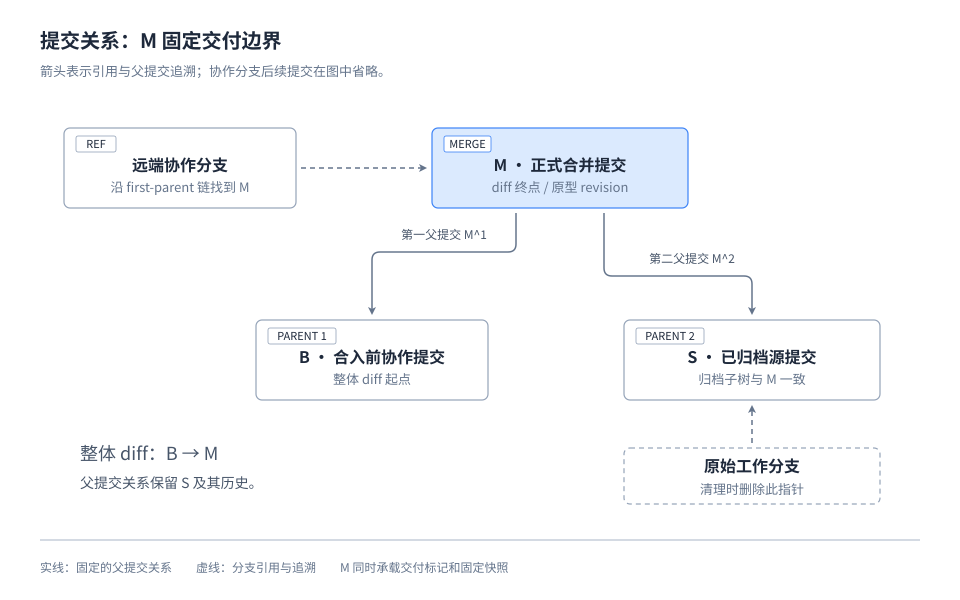
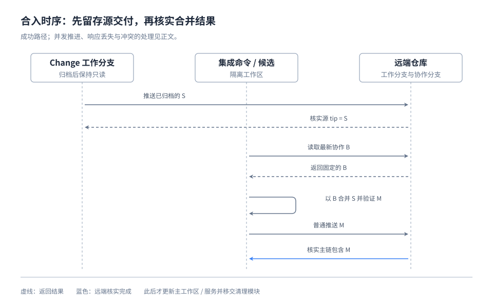
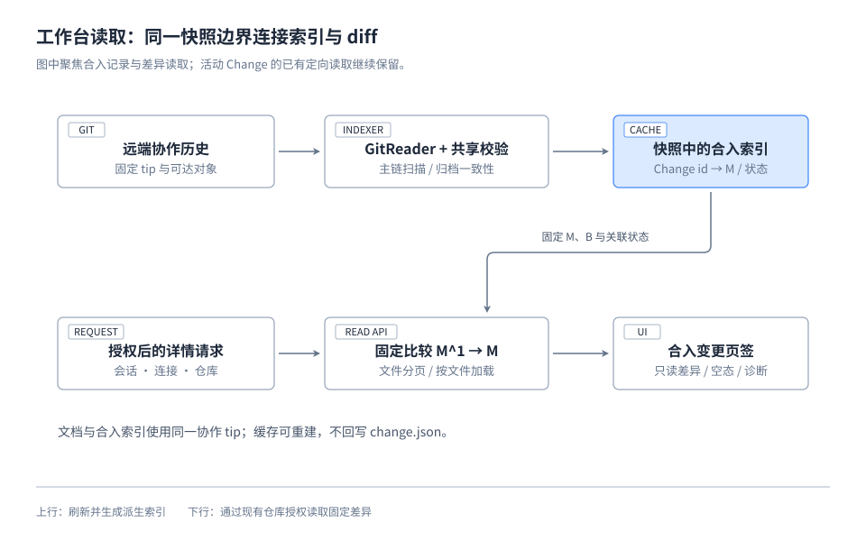
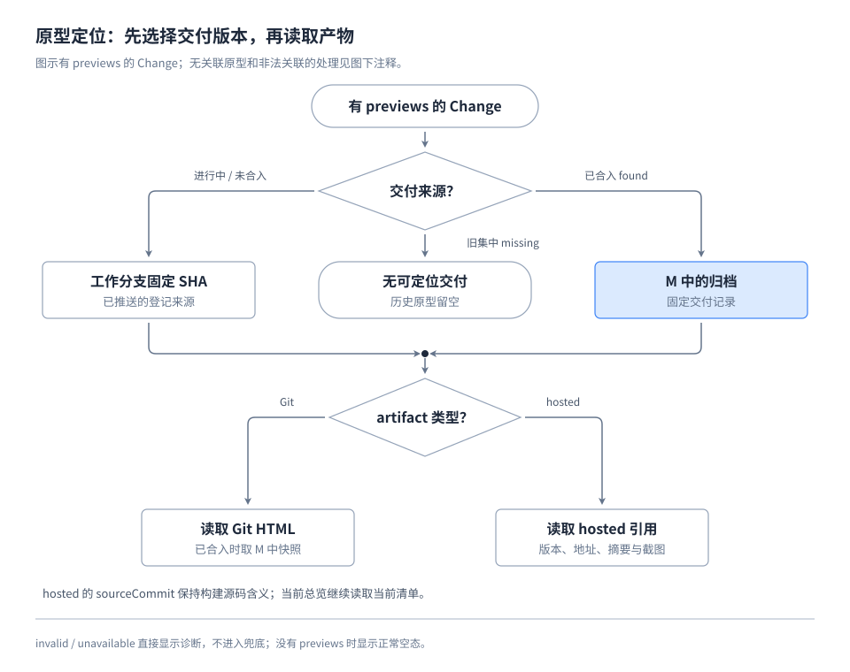
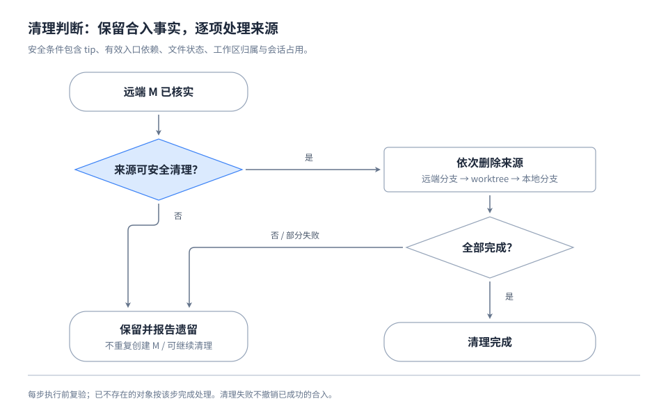

# Change 合入记录、整体 diff 与来源清理

## 方案边界

按 [Requirement](requirement.md) 交付：归档后一次合入，Git 合并提交保存交付边界，工作台据此读取 diff 与原型，远端核实成功后清理来源。PR、工作分支和保留标签均不承担历史索引职责。

方案按五个不同职责的模块说明：**提交协议、集成命令、工作台读取、原型定位、来源清理**。各模块的图展示关系或关键路径；校验条件、异常处理和接口细节留在对应正文。旧标签切换是线性操作，单独用顺序表说明。

复用现有集中路由、GitReader、仓库授权和 Store 快照；合入记录的识别规则放入 SpecTrail 的零依赖共享模块，供 CLI 与服务端调用。`change.json`、workflow 和原型 artifact 的持久化契约保持原意，合入索引是可重建的派生数据。现状依据见 [Research](research.md)。

## 1. 提交协议：什么代表一次交付

### 提交与引用关系



图中箭头表示引用或向父提交追溯，**不是执行先后**。协作分支后续推进时，仍沿 first-parent 链找到 M；省略的中间提交不改变下列关系。

| 符号 | 含义 | 用途 |
| --- | --- | --- |
| B = M^1 | 合入前的协作分支提交 | 整体 diff 的起点 |
| S = M^2 | 已归档并推送的源提交 | 验证交付归档未被合入过程修改 |
| M | 本次双亲合并提交 | diff 终点、历史原型的固定 revision |

从 B 使用 `--no-ff` 合并 S，即使可快进也生成 M，保留原始提交。提交信息统一为：

```text
Merge Change <id> into <collaboration-branch>

SpecTrail-Change: <id>
```

标题供人阅读；关联只识别末尾 trailer 区域中唯一、精确的 `SpecTrail-Change` 键及合法 id，不通过标题、分支名或正文提及猜测。内部任务合并、协作分支同步和规划检查点不加此标记。一个 M 只交付一个 Change，不支持提前分批合入。

### 有效记录的判断

以固定的远端协作 tip 为边界，沿 first-parent 链收集标记。相同 id 出现多次即诊断，不取最新记录掩盖异常。唯一候选还须满足：

1. M 恰有两个父提交，所需对象均可读。
2. M 内有唯一有效 completed 归档，关闭步骤、目录与 `closure.archive.path` 一致，同 id 不残留于 changes。
3. M^1 尚无该 id 归档；M 相对 M^1 新增的归档 id 集合恰为该 id。
4. M^2 内有同一有效归档，且其**整个归档子树**与 M 一致，包括状态、正文、证据及 Git 原型快照。

判断只依赖固定提交，不依赖待删除的源分支。合入后不回填 SHA 或修改归档，`change.json.branch` 仅保留历史归属。记录表示当时的交付，不推断代码当前是否生效，也不按提交标题猜测回滚状态。

## 2. 集成命令：怎样形成可追溯的 M



图示为成功路径；并发与失败按下表处理。增加 SpecTrail 集成入口，提供预检、集成及继续清理操作，复用精确远端查询和仓库锁，输出可审阅的提交身份与操作结果。

归档前先同步协作分支、解决冲突并验证。归档后固定源提交 S，推送并核实远端；再取最新 B，在隔离候选中生成 M，核对单次交付范围、协议和相关验证。主工作区不承担冲突处理，不混入无关改动。

普通推送 M 后重新查询远端，确认 M 位于远端协作 tip 的 first-parent 链；远端可以已继续前进，不要求 tip 恰等于 M。随后安全快进主工作区，按项目规则更新服务，再移交清理模块。协作分支不 force push。

| 情况 | 处理 |
| --- | --- |
| B 并发推进导致推送被拒绝 | 查询最新远端；已有同 id 的有效 M 则复用，否则从新 B 重建未发布候选并复验。 |
| 推送响应丢失、结果未知 | 先核实远端，不能直接重复创建 M 或删除来源。 |
| 源分支出现新提交 | 不把新工作自动纳入已归档交付，停止受影响的集成或清理。 |
| 冲突需要修改已归档交付 | 保留现场，通过新 Change 处理，不将旧归档恢复为 active。 |
| 源交付已通过非标准路径提前合入且无合法 M | 报告不支持的状态，不伪造补合并记录。 |

重试时不能在旧候选上再“合并远端协作分支”，否则其他交付可能落到 second-parent 历史，失去主链索引。

普通 Change 使用自己的工作分支。仅规划的 xlarge 父项在最终归档前转入独立关闭分支形成 S；其 M 只表示父项交付，各子 Change 保留各自的 M，不聚合为一个总 diff。

## 3. 工作台：从 Change 找到整体差异



### 索引与数据边界

GitReader 固定协作 tip 并拉取完整可达历史，分批扫描 first-parent 提交，只对带标记候选读取归档校验。已有 active Change 的定向来源读取保留；不扫描全部远端分支或标签恢复关联。

索引按仓库身份、协作分支、tip 和协议版本缓存。新 tip 的 first-parent 链包含旧 tip 时可追加区间，否则重建；文档与索引使用同一 tip。读取中远端变化时保留固定的完整快照，或整体重建，不能混用两个边界。

| 派生结果 | 证据条件 | 详情表现 |
| --- | --- | --- |
| found | 唯一标记且通过协议校验 | 返回 M、B、S、归档路径、标题和提交时间 |
| missing | 扫描完整，未发现标记 | “暂无合入记录”，不推断从未合入 |
| invalid | 标记重复或协议校验失败 | 对应诊断及可识别的候选提交 |
| unavailable | 历史不完整、对象缺失或读取失败 | 读取失败与重试入口，不冒充 missing |

更新快照 schema 与扫描 fingerprint，用合入索引替换 `archiveRefs/archivePins`。旧快照失效后重建，旧快照链接提示刷新；即使文档树相同，合入索引变化也进入一致性判断。单个无效 id 不阻断其他文档，整体扫描未完成时不能对未查明的 id 报 missing。

### 差异接口与呈现

沿用仓库 API 的会话、connectionId、仓库身份、协作分支和权限复验。以下接口均相对于现有仓库 API 路径，要求指定快照：

| 接口 | 返回 |
| --- | --- |
| `changes/<id>/integration?snapshot=<snapshot>` | 关联结果、提交身份、时间、文件总数与统计 |
| `changes/<id>/integration/files?snapshot=<snapshot>&cursor=<cursor>` | 分页文件清单：fileId、旧/新路径、变更类型、增删数、可展示性 |
| `changes/<id>/integration/files/<fileId>?snapshot=<snapshot>` | 单文件 diff、行号及展示限制 |

服务端从有效记录派生 B、M，比较 `git diff M^1 M`；不接受任意 base/head 或路径。fileId 绑定提交对和原始路径并回查清单，cursor 绑定快照与提交对。缓存不绕过仓库权限，私有 diff 不进入匿名原型接口。

清单与统计使用 NUL 分隔，保留特殊文件名，显示时转义控制字符。禁用 external diff 和 textconv，使用参数数组及字面 pathspec；重命名策略在清单、统计和正文中一致。展示全部目录，包括归档移动，默认统一 diff、三行上下文和新旧行号，正文按文件加载。

二进制、非 UTF-8、LFS 指针、子模块、符号链接和 mode-only 变化明确标识；不读取外部指针内容或跟随符号链接，不可统计项不伪填零。单文件初始展示上限为 1 MiB 或 10000 行，超限保留元信息并提示未完整展示，可复制固定 Git 比较命令；列表分页可遍历全部文件，整体读取受限时明确失败或不完整，不能冒充完整统计。

Change 详情新增“合入变更”页签（`ct=integration`），由提交摘要、文件列表和正文组成。支持窄屏、键盘、直接链接与前进后退；切换仓库、Change 或快照时丢弃过期响应。对应 UI 原型在进入实现前准备并验收。

## 4. 原型：交付定位与产物读取分开



图示聚焦有 previews 的 Change。先按集中路由判定交付来源，再按 artifact 类型读取；工作分支来源沿用固定 SHA，不依赖新增合入索引。构建源码提交与交付定位提交分别保留各自含义。

| 来源 | 固定 revision 与行为 |
| --- | --- |
| 已合入且 found | revision=M，从 M 的归档读取 previews。 |
| 集中归档但 missing | 显示“未记录可定位的交付版本”，不通过标签、最新 tip 或 sourceCommit 猜测。 |
| 集中归档的合入记录 invalid/unavailable | 显示诊断，不回退工作分支。 |
| 进行中或仅在登记工作分支归档 | 从已核实的已推送分支固定 SHA，沿用来源与产物校验。 |
| 项目当前总览 | 继续读取协作分支当前清单。 |

Git 产物读取固定 revision 中由该 Change 记录指定的 HTML；已合入时从 M 的归档路径读取，归档子树一致性校验证明合入未改变它。hosted 直接使用记录中的 version、url、digest、thumbnails，`artifact.sourceCommit` 保持构建源码含义。

已合入 Change 的新准备请求固定到 M，不能仅凭任意祖先 SHA 可达而绕过定位；集中旧归档显式传 revision 也不恢复旧标签逻辑。没有关联原型时保留原有正常空态。

清理前校验引用结构、Git 文件及源码对象可读。外部产物由宿主承担留存，沿用发布适配器和浏览器的可用性验证，不新增服务端代理抓取。已准备的公开版本由现有持久发布记录服务，不因源分支或标签删除重新查询 Git，也不随此次切换回收。

## 5. 清理：合入成功与清理完成分别判断



继续清理以远端有效 M 为交付依据，可以处理源分支或 worktree 已部分删除的情况。操作结果分别报告合入、远端核实及每个对象的 cleaned/retained/failed，不把清理失败写成合入失败，也不因此重新生成 M。

| 检查范围 | 可以清理的条件 |
| --- | --- |
| 交付证据 | M 已在远端协作 first-parent 链，归档与原型读取前提成立。 |
| 本地及远端源 tip | 待删提交均已包含于 M，无后来新增的未合入工作。 |
| 来源依赖 | 无其他 active/cancelled Change 的有效入口依赖；继承旧副本不算新增依赖。 |
| worktree | 仓库、路径和登记分支一致，无未提交、未跟踪或未知忽略文件。 |
| 占用与保留边界 | 无继续写入的会话或服务，不是主工作区、协作分支、保护分支或用户数据。 |

执行位置先移出待删 worktree。Agent 核实客户端和服务占用，脚本检查 Git 锁、登记及文件状态；无法确认时保留现场。已知可重建依赖和构建产物按项目约定处理，独有环境配置或资料不能当作缓存删除。

完成预检后，按“远端源分支 → 本地 worktree → 本地源分支”清理，每步复验。远端采用预期 tip 条件进行原子比较删除，tip 变化即拒绝；本地以已合并条件删除，不使用强制 worktree 移除或无条件强删分支。远端无删除权限时保留本地来源并报告。

推送或核实失败不进入清理。清理部分成功时保留并报告剩余对象，重试重新证明远端事实；已不存在的对象视作该步完成。最终证据留在 Git、命令输出和交付报告，不回填归档。

## 6. 旧标签退出：一次切换，旧关联留空

不建立历史映射或双版本兼容读取。实际切换顺序如下：

| 顺序 | 操作与完成依据 |
| --- | --- |
| 1 | 同一交付更新主/原型 skill、归档命令提示及发布说明，停止创建保留标签，读取端支持新协议。 |
| 2 | 验收并归档本 Change，以新协议形成 M、推送核实，再更新开发机长期服务。 |
| 3 | 用全新缓存验证新记录、旧记录空态、当前总览和公开版本；重新列出目标标签清单。 |
| 4 | 核实无执行会话继续使用旧归档脚本，对精确的 `spec-trail/archive-v2/*` 清单按预期对象删除远端标签，再删本地标签；发现并发变化先核实来源。 |
| 5 | 在缓存写锁下删除 `refs/openfolio/archive-v2/*` 及失效标签快照，重建受影响缓存。 |

仅清理该命名空间和可重建缓存，不删除外部产物、现有公开版本、当前清单、登录、凭据或偏好；无需立即 Git GC。旧归档正文仍可读，找不到关联的 diff 和原型留空。标签删除失败作为清理遗留报告，不恢复旧协议。

实现阶段交付命令、校验和演练证据，真实删除在新服务生效后执行；不为了提前完成实现任务而删除旧服务仍依赖的标签，也不在切换后补写归档。

## 7. 验证与交付

复用现有 Node 测试、Git fixture 和 Playwright，按实际缺口补充验证。各模块采用能直接观察结果的方法，避免重复验证同一断言。

| 模块 | 关键证据 |
| --- | --- |
| 提交与索引 | 临时 bare 远端覆盖可快进/分叉合入、非法或重复标记、归档不一致、多 Change 混入及不完整历史。删除来源后，从只取协作分支的新仓库重建索引。 |
| 集成与清理 | 验证并发推进、推送结果未知、源 tip 变化、有效来源依赖、脏/忽略文件、权限不足和部分失败重试；破坏性检查只用临时工作区。 |
| 整体 diff | 对照实际 `git diff M^1 M` 的文件集合与文本；检查归档移动、特殊文件名和展示限制，以及授权、fileId/cursor 与跨仓库边界。 |
| 原型 | 删除分支与标签后仍可读取新 Git/hosted 交付；sourceCommit 不变，活动及未合入固定版本、旧记录空态、当前总览和公开版本符合约定。 |
| 交互与集成 | 检查页签、选文件、空态/失败、窄屏与键盘；按改动运行相关回归、类型检查及构建，完成独立评审和用户验收。 |

验收后同步 workflow、Change tracking 和 prototype preview Specs，再按项目 AGENTS 更新长期服务并完成登录冒烟。执行计划在技术方案确认后形成。
