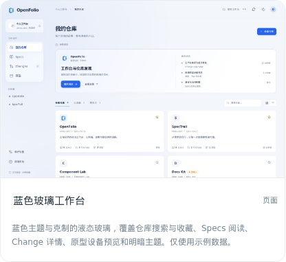
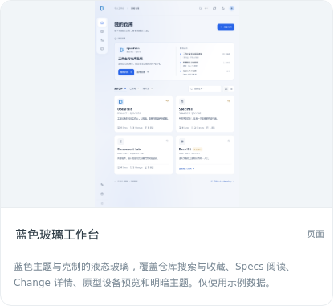
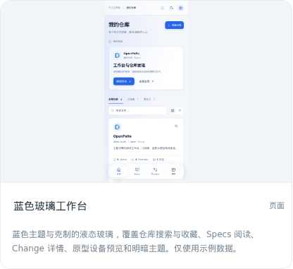

# 原型材料

## 需求来源

用户最初要求探索更现代、易读、易操作、冗余信息少且漂亮的后台，保留蓝色主题，少量组件使用苹果液态玻璃风格，并授权自由探索、先输出原型。后续要求发布该原型，以便从 OpenFolio 原型总览直接访问。

用户已明确整体目标是大型前端样式与交互重构，现阶段继续围绕原型讨论。现有发布检查仅证明原型可访问和可操作，不表示需求、设计方案或正式产品改版已经验收。

## 第一版讨论稿

[打开蓝色玻璃工作台原型](https://pub-cc623a99ce8e4606a3491cc2d4b4436c.r2.dev/open-folio/b5795adb098c8063f19e164f7257d1836e69cee2e2534dee955426571e066f0a/index.html)

第一版包含仓库搜索与收藏、Specs 阅读、Change 详情、原型设备快照和明暗主题，使用示例数据，操作在内存中运行。正式工作台尚未应用这一视觉方案。

此前已验证原型在桌面、iPad、手机和 320px 窄屏的布局及主要交互；真实总览三种设备的卡片图片均加载成功。下面的卡片截图是发布检查证据，仅用于对照当前讨论稿。

## 六组明暗主题原型（已被第二轮返工取代）

2026-10-22 用户审阅后要求返工（见 [Requirement](requirement.md#第二轮返工2026-10-22)），本版不再请求验收，以下记录仅作对照。

用户确认需求并授权提交、推送和设计原型；需求确认提交为 `11284f8`。新设计以 `develop@fee9a9f` 已集成产品与本 Change 的需求为依据，旧蓝色玻璃稿仅保留参考。六组入口为 `quiet-home`、`quiet-specs`、`quiet-changes`、`quiet-prototypes`、`quiet-credentials`、`quiet-public`，共同支持浅色/深色和桌面、平板、手机。设计规则及 shadcnuikit 参考 id 见 [DESIGN.md](../../../../packages/prototype/DESIGN.md)。

原型仅使用虚构数据和内存交互；登录接受 `demo` / `demo-other`，对应现有 Token 身份模型。工程记录只读，不增加搜索、收藏、统计、批量写入或账号密码能力。Changes 的材料均标明虚构示例，不是本 Change 的 Technical/Plan。表单采用内存事件并支持 Enter，兼容工作台仅授予 `allow-scripts` 的 iframe。正文为实底，玻璃仅用于局部功能层，并支持透明度和动态效果降级。

### 本地验证（2026-10-19 UTC）

`npm run build --workspace prototype` 成功；`node packages/prototype/verify-quiet-workbench.mjs` 完成 86 项断言，失败 0、浏览器错误 0。

- 六入口 × 两主题 × 四档尺寸（1440×900、834×1194、390×844、320×720）共 48 项布局检查均无页面横向溢出；长文与画布局部滚动保持在阅读区内。
- 在真实不透明 iframe 沙箱及项目 CSP 下验证键盘导航、可见焦点、Escape 与嵌套弹窗焦点恢复、手机目录、触摸入口、过滤与分页、问答、只读任务视图、合入差异和限制状态。
- 设备画布的尺寸、旋转、适应/100% 映射准确；卡片截图与标题分别进入预览和详情，固定分享及匿名权限边界可演示。
- Token 添加/去重、切换失败保留当前身份、不同 Token 工作台隔离、设备退出范围、复制失败回退、减少透明度与减少动态效果通过。
- 验证加载、空态、部分失败、无匹配、离线、无权限、会话失效、来源失败、材料缺失、合入失败、未发布和公开链接撤回等场景。
- 六入口均执行包内正式 screenshot 命令，生成桌面、iPad、手机共 18 张标准卡片图；另保留两主题共 36 张布局检查图。结果和截图位于忽略目录 `artifacts/quiet-workbench/`。

仅更新原型包和本 Change 文档/语义状态；不修改产品前端代码、不编写 Technical/Plan，也不记录原型验收。固定发布和真实工作台检查记录如下。

### 固定发布

R2 固定版本 `dc671716fc3ceadc3eb7dc47fe201adeb06923357abc17024f3c4819ad4543c0`，源码提交 `300bb77e2fb00c706cee6883bfefc9c175beac5f`，内容摘要 `sha256:aaa9a50dfde0d0aa8c01a9fac895760d27a69a5b4dfeaa1ae5f5dd1a0d88cccb`。通过公开 GET 对所有上传字节和 MIME 校验后，使用 SpecTrail `publish register` 登记六入口；每项均包含桌面、iPad、手机缩略图，旧引用保持原值。

| 入口 | 浅色 | 深色 |
| --- | --- | --- |
| 仓库与导航 | [打开原型](https://pub-cc623a99ce8e4606a3491cc2d4b4436c.r2.dev/open-folio/dc671716fc3ceadc3eb7dc47fe201adeb06923357abc17024f3c4819ad4543c0/quiet-home/index.html) | [打开深色](https://pub-cc623a99ce8e4606a3491cc2d4b4436c.r2.dev/open-folio/dc671716fc3ceadc3eb7dc47fe201adeb06923357abc17024f3c4819ad4543c0/quiet-home/index.html#/home?theme=dark) |
| Specs 阅读 | [打开原型](https://pub-cc623a99ce8e4606a3491cc2d4b4436c.r2.dev/open-folio/dc671716fc3ceadc3eb7dc47fe201adeb06923357abc17024f3c4819ad4543c0/quiet-specs/index.html) | [打开深色](https://pub-cc623a99ce8e4606a3491cc2d4b4436c.r2.dev/open-folio/dc671716fc3ceadc3eb7dc47fe201adeb06923357abc17024f3c4819ad4543c0/quiet-specs/index.html#/specs?theme=dark) |
| Changes 与详情 | [打开原型](https://pub-cc623a99ce8e4606a3491cc2d4b4436c.r2.dev/open-folio/dc671716fc3ceadc3eb7dc47fe201adeb06923357abc17024f3c4819ad4543c0/quiet-changes/index.html) | [打开深色](https://pub-cc623a99ce8e4606a3491cc2d4b4436c.r2.dev/open-folio/dc671716fc3ceadc3eb7dc47fe201adeb06923357abc17024f3c4819ad4543c0/quiet-changes/index.html#/changes?theme=dark) |
| 原型总览与画布 | [打开原型](https://pub-cc623a99ce8e4606a3491cc2d4b4436c.r2.dev/open-folio/dc671716fc3ceadc3eb7dc47fe201adeb06923357abc17024f3c4819ad4543c0/quiet-prototypes/index.html) | [打开深色](https://pub-cc623a99ce8e4606a3491cc2d4b4436c.r2.dev/open-folio/dc671716fc3ceadc3eb7dc47fe201adeb06923357abc17024f3c4819ad4543c0/quiet-prototypes/index.html#/prototypes?theme=dark) |
| Token 登录与凭据 | [打开原型](https://pub-cc623a99ce8e4606a3491cc2d4b4436c.r2.dev/open-folio/dc671716fc3ceadc3eb7dc47fe201adeb06923357abc17024f3c4819ad4543c0/quiet-credentials/index.html) | [打开深色](https://pub-cc623a99ce8e4606a3491cc2d4b4436c.r2.dev/open-folio/dc671716fc3ceadc3eb7dc47fe201adeb06923357abc17024f3c4819ad4543c0/quiet-credentials/index.html#/credentials?theme=dark) |
| 匿名公开预览 | [打开原型](https://pub-cc623a99ce8e4606a3491cc2d4b4436c.r2.dev/open-folio/dc671716fc3ceadc3eb7dc47fe201adeb06923357abc17024f3c4819ad4543c0/quiet-public/index.html) | [打开深色](https://pub-cc623a99ce8e4606a3491cc2d4b4436c.r2.dev/open-folio/dc671716fc3ceadc3eb7dc47fe201adeb06923357abc17024f3c4819ad4543c0/quiet-public/index.html#/public?theme=dark) |

顶部「设计预览」可切换六组页面与场景，页面内主题按钮切换明暗。每个入口的固定目录另含 `dark-pc-web.png`、`dark-ipad.png`、`dark-mobile.png`，用于对照深色外观；它们是检查图，当前卡片仍使用标准设备缩略图。

该版本未经用户验收即进入第二轮返工。

### 真实工作台发布核验（2026-10-19 UTC）

固定引用推送至 `develop@ef05ff5` 后，用 `withSmokeSession` 创建独立真实登录并刷新 OpenFolio 仓库。26 项发布检查通过，测试结束后包装器已读取最新会话版本、退出自身授权并核验当前及记住的测试身份均已清除。首次坐标定位失败及后续重试也由同一包装器分别完成清理。

- 真实原型清单读取六个新入口；发布 result、清单与 Change 的版本/源码/摘要/设备缩略图一致，历史蓝色玻璃引用原样保留。
- 在真实总览逐项切换 PC Web、iPad、移动设备筛选，六张卡片共 18 张图片均满足 `img.complete && naturalWidth > 0`，图片地址属于本次固定版本。
- 从六张卡片分别进入预览，确认 iframe 仍只授予 `allow-scripts`；实际鼠标点击可以切换浅色/深色，加载/正常场景也可以切换。最终检查无浏览器运行错误。
- 自动化最初将 iframe 内坐标直接叠加到宿主位置，未计入画布 CSS 缩放，导致点击越界；按实际缩放后的鼠标坐标重试通过，未更改原型或产品来绕过限制。
- `node .agents/skills/spec-trail/prototype/scripts/validate.mjs --browser` 对当前 13 个已登记入口的 Chromium 沙箱加载检查通过。产品代码没有变更，此次仅刷新远端项目引用，不重建长期服务。

本地交互及尺寸断言见 [86 项本地检查](assets/quiet-local-checks.json)，真实卡片与预览断言见 [26 项发布检查](assets/quiet-published-checks.json)。真实总览三设备截图与六个预览检查截图保留于忽略目录 `artifacts/quiet-workbench/published-*.png`；此处不包含真实凭据或会话数据。

## 第二轮体验审查（2026-10-22）

以产品经理视角逐页检查上一版六组原型（`300bb77`）与当前产品（`develop@9de1e5a`）。每项列出问题、证据与新原型的处理；“前端组合”表示复用工作台已加载的数据，“需后端配合”留到技术方案评估。

### 公共壳层

| # | 类型 | 问题与证据 | 处理 |
| --- | --- | --- | --- |
| A1 | 冗余 | 当前仓库与模块在侧栏切换器、顶栏面包屑、页面大标题三处重复 | 侧栏展开时顶栏不再显示仓库；侧栏收起或手机时，顶栏出现紧凑的仓库切换 |
| A2 | 冗余 | 身份入口三处：侧栏底部、顶栏设置图标、首页右上角“GitHub · 账号” | 合并为侧栏底部账号菜单：切换 Token、主题、账号与 Token 设置、退出 |
| A3 | 易用 | 顶栏五个图标（读取状态、来源、刷新、主题、设置）语义相近，需逐个辨认 | 合为一个“同步状态”按钮，弹层内显示来源、提交与刷新；主题移入账号菜单 |
| A4 | 样式 | 内容面内再浮一层玻璃顶栏，层级重、占高 64px | 顶栏融入内容面，高 52px，滚动后才出现细分隔 |
| A5 | 易用 | 收起入口是顶栏小图标，收起后是普通窄栏 | 点击 Logo 切换；收起为垂直居中的悬浮胶囊图标导航（用户要求），平板默认收起 |
| A6 | 样式 | 侧栏选中项蓝底、蓝字加左侧竖条，强调过重 | 中性选中底，只有图标用强调色 |

### 页面标题与说明文字

| # | 类型 | 问题与证据 | 处理 |
| --- | --- | --- | --- |
| B1 | 冗余 | 眉标（“项目记录”“设计与交付”“身份与访问”）和口号式副标题占据首屏 | 删除；标题旁只放真实数量摘要 |
| B2 | 冗余 | 说明性脚注（“状态来自实际记录”“仅显示已发现的仓库”） | 删除；必要说明放进空态或对应弹层 |

### ① 我的仓库

| # | 类型 | 问题与证据 | 处理 |
| --- | --- | --- | --- |
| C1 | 冗余 | “阅读来源”列每行都是 develop | 删除该列；协作分支并入路径行，以弱化文字显示 |
| C2 | 控件 | 全部 / 可阅读 / 需要关注页签：仓库通常不多，筛选的价值低 | 删除；需要处理的仓库单独分组，附原因和“重新检查” |
| C3 | 冗余 | 每行都有“可阅读”徽标 | 正常状态不标，只标异常 |
| C4 | 能力变化 | 仍是 Token 登录与浏览器身份 | 未登录进入账号登录；已登录无 Token 时引导绑定首个 Token |

### ② Specs

| # | 类型 | 问题与证据 | 处理 |
| --- | --- | --- | --- |
| D1 | 冗余 | “只读文档”“示例快照”标记：工作台本就只读 | 删除 |
| D2 | 易用 | 本文目录挤在能力树下方，树一长就看不到 | 宽屏移到正文右侧并随滚动高亮；窄屏收为“目录”弹层 |
| D3 | 信息 | 能力和 Change 的关系只能在 Change 侧看到 | 文末列出“相关 Change”（前端组合 Change 的关联能力） |
| D4 | 易用 | “查看原文”“复制阅读链接”在文末，长文里难找 | 移到正文顶部的更多菜单 |

### ③ Changes

| # | 类型 | 问题与证据 | 处理 |
| --- | --- | --- | --- |
| E1 | 控件 | 产品有 6 个范围页签、最多 7 个筛选控件、变更/任务切换和三种视图，分三行 | 一行：范围分段（进行中 / 已完成 / 已取消）+“筛选”+“显示” |
| E2 | 控件 | 阶段、等待/阻塞筛选：用户真正想知道的是“哪些需要处理” | 进行中默认按“等待确认 / 受阻 / 推进中”分组，替代这两个筛选 |
| E3 | 控件 | 规模、关联能力、任务状态筛选与任务粒度切换使用频率低 | 删除。规模在行内显示；关联能力改由 Specs 反查；任务进度在行内、明细在详情 |
| E4 | 控件 | 保留的筛选应少而有用 | 类型、紧急程度、创建者三类，收入同一弹层；选中后以可单独清除的标签显示 |
| E5 | 视图 | 全局依赖图只在少数 xlarge 场景有用 | 删除全局视图；依赖、父子与延续在详情“关联”中展示。看板保留，仅用于进行中 |
| E6 | 控件 | “来源异常”作为常驻页签，通常为空 | 有异常时才在列表上方出现提示条，点击查看 |
| E7 | 能力同步 | 交付标签与 PR（`pr-release-delivery`）未体现 | 进行中行内显示 PR 状态；已完成按“待发布 / 已发布 / 交付待核实”分组，作为便捷入口 |
| E8 | 信息外露 | 列表看不到创建者和创建时间，紧急程度与类型只在详情或筛选中出现 | 增加创建者与创建时间列（创建者需后端配合）；紧急、高显示旗标，类型标签直接显示，任务进度显示数字，阻塞单独标红 |
| E9 | 易用 | 详情是 640px 抽屉，6 个页签内读长文拥挤 | 改为完整阅读页：材料目录 + 正文 + 本页目录，与分享页同一布局；返回保留列表位置，支持上一项 / 下一项 |
| E10 | 能力同步 | 分享入口缺失 | 详情顶部“分享”弹层：复制链接、打开分享页，并说明拿到链接的人都可阅读 |

### ④ 原型

| # | 类型 | 问题与证据 | 处理 |
| --- | --- | --- | --- |
| F1 | 控件 | 全部/页面/组件页签加适配下拉 | 只保留“预览设备”分段，同时切换卡片缩略图；组件以小标签标注 |
| F2 | 冗余 | 每张卡片都有相同的“固定版本”标记 | 删除；改为显示关联 Change（前端组合）与公开状态 |
| F3 | 样式 | 缩略图是骨架线条，看不出页面差异 | 用缩小的页面渲染（真实产品使用已发布截图） |

### ⑤ 账号与 Token

| # | 类型 | 问题与证据 | 处理 |
| --- | --- | --- | --- |
| G1 | 能力同步 | 上一版仍按浏览器身份集合设计 | 账号登录 / 注册；Token 归属账号，可命名、选用、解绑和复制当前 Token；设备按账号列出 |
| G2 | 结构 | “当前 Token”单独一节只放一个复制按钮 | 并入 Token 列表，在当前项菜单中复制 |
| G3 | 风险 | 退出全部设备与普通操作并列 | 放在页面底部，确认时说明 Token 会保留 |

### ⑥ 公开原型与 ⑦ Change 分享

| # | 类型 | 问题与证据 | 处理 |
| --- | --- | --- | --- |
| H1 | 冗余 | 公开原型页顶栏和标题区都显示名称与版本 | 合为单行顶栏，画布占满剩余空间 |
| H2 | 一致性 | 分享页使用独立的视觉系统 | 与工作台 Change 详情共用阅读布局，只去掉私有导航和操作 |

### 需后端配合

- **Change 创建者**：Git 读取层在追溯首次提交时间时一并返回首次提交作者；平台账号可识别时显示头像或登录名，否则显示 Git 作者名。

其余调整只使用已有数据，或只删减、合并界面。

### 第二轮原型验证与固定发布（2026-10-22）

源码提交 `597c114`。七组入口 `quiet-home`、`quiet-specs`、`quiet-changes`、`quiet-prototypes`、`quiet-credentials`、`quiet-public`、`quiet-share` 共用 `packages/prototype/src/shared/quiet-workbench/` 的模块，均支持浅色 / 深色及桌面、平板、手机；设计规则见 [DESIGN.md](../../../../packages/prototype/DESIGN.md#frontend-style-interaction-refactor-需求设计草案)。

本地验证：`npm run build --workspace prototype` 成功；`npm test --workspace prototype` 16 项通过；`node packages/prototype/verify-quiet-workbench.mjs` 121 项通过、失败 0、浏览器错误 0。检查在仅授予 `allow-scripts` 的 iframe 与项目 CSP 下运行：

- 布局：七个入口及 Change 详情、合入差异、原型画布、登录页，在浅色、深色与 1440×900、834×1194、390×844、320×720 四档宽度下，页面、正文、顶栏与工具栏均无横向溢出。
- 侧栏：点击 Logo 收起为四个图标的悬浮胶囊并可再次展开，Enter 与 Ctrl+\ 可切换，焦点留在 Logo；平板默认收起，手机为底部胶囊导航。
- Changes：默认按“等待确认 / 受阻 / 推进中”分组并显示创建者；按创建者筛选、标签移除、看板五列、不分组时按紧急程度排序；已完成按“待发布 / 已发布”分组；来源异常从提示条进入；返回列表后焦点回到原行。
- 详情与分享：材料目录、未产生与缺失材料、随滚动高亮的本页目录、任务以图标和文字表达（无复选框）；分享弹层的链接、沙箱内复制失败的手动兜底及焦点恢复；分享页无工作台导航与账号，内嵌原型画布，不存在与同步失败状态。
- Specs、原型、账号：相关 Change 与原文、手机目录面板；按设备切换缩略图、详情面板、设备 / 旋转 / 100% 与公开链接；公开页的不存在与已撤回；Token 验证失败不保存、示例 Token 添加并选用、非当前 Token 不可复制、解绑与设备退出需确认、切换失败保留原 Token；登录错误、注册重名、注册后引导绑定首个 Token。
- 状态与降级：离线保留内容，无权限清除私有内容，登录过期回到登录页；减少透明度后胶囊无 `backdrop-filter`，减少动态效果后过渡为 0；跳过链接聚焦主内容且不改变路由。

结果与截图位于忽略目录 `artifacts/quiet-workbench/`（`verification.json` 及浅色 / 深色的桌面、平板、手机截图）。

固定发布：R2 version `676ba2c92391152ca28baafc70a626fcd53737b4f2a8ad1a1d80dc1929513f24`，sourceCommit `597c11495ffa13a0392a6bd48b5528372f26c79b`，digest `sha256:a98fa67d195d9955e48f0a13f6b958301dd4e846bcb324f7e383d6e89d385ec5`。适配器逐个公开读取并校验字节后返回成功；`publish register` 更新当前清单与本 Change 的七个入口，每项含桌面、iPad、手机缩略图；`validate.mjs --browser` 对 15 个已登记入口的 Chromium 沙箱加载检查通过。上一版 `dc671716…` 的固定链接保持可访问。

| 入口 | 浅色 | 深色 |
| --- | --- | --- |
| 我的仓库与侧栏 | [打开](https://pub-cc623a99ce8e4606a3491cc2d4b4436c.r2.dev/open-folio/676ba2c92391152ca28baafc70a626fcd53737b4f2a8ad1a1d80dc1929513f24/quiet-home/index.html) | [打开](https://pub-cc623a99ce8e4606a3491cc2d4b4436c.r2.dev/open-folio/676ba2c92391152ca28baafc70a626fcd53737b4f2a8ad1a1d80dc1929513f24/quiet-home/index.html#/home?theme=dark) |
| Specs 阅读 | [打开](https://pub-cc623a99ce8e4606a3491cc2d4b4436c.r2.dev/open-folio/676ba2c92391152ca28baafc70a626fcd53737b4f2a8ad1a1d80dc1929513f24/quiet-specs/index.html) | [打开](https://pub-cc623a99ce8e4606a3491cc2d4b4436c.r2.dev/open-folio/676ba2c92391152ca28baafc70a626fcd53737b4f2a8ad1a1d80dc1929513f24/quiet-specs/index.html#/specs/maps/offline?theme=dark) |
| Changes 与详情 | [打开](https://pub-cc623a99ce8e4606a3491cc2d4b4436c.r2.dev/open-folio/676ba2c92391152ca28baafc70a626fcd53737b4f2a8ad1a1d80dc1929513f24/quiet-changes/index.html) | [打开](https://pub-cc623a99ce8e4606a3491cc2d4b4436c.r2.dev/open-folio/676ba2c92391152ca28baafc70a626fcd53737b4f2a8ad1a1d80dc1929513f24/quiet-changes/index.html#/changes?theme=dark) |
| 原型总览与画布 | [打开](https://pub-cc623a99ce8e4606a3491cc2d4b4436c.r2.dev/open-folio/676ba2c92391152ca28baafc70a626fcd53737b4f2a8ad1a1d80dc1929513f24/quiet-prototypes/index.html) | [打开](https://pub-cc623a99ce8e4606a3491cc2d4b4436c.r2.dev/open-folio/676ba2c92391152ca28baafc70a626fcd53737b4f2a8ad1a1d80dc1929513f24/quiet-prototypes/index.html#/prototypes?theme=dark) |
| 账号与 Token | [打开](https://pub-cc623a99ce8e4606a3491cc2d4b4436c.r2.dev/open-folio/676ba2c92391152ca28baafc70a626fcd53737b4f2a8ad1a1d80dc1929513f24/quiet-credentials/index.html) | [打开](https://pub-cc623a99ce8e4606a3491cc2d4b4436c.r2.dev/open-folio/676ba2c92391152ca28baafc70a626fcd53737b4f2a8ad1a1d80dc1929513f24/quiet-credentials/index.html#/account?theme=dark) |
| 匿名公开原型 | [打开](https://pub-cc623a99ce8e4606a3491cc2d4b4436c.r2.dev/open-folio/676ba2c92391152ca28baafc70a626fcd53737b4f2a8ad1a1d80dc1929513f24/quiet-public/index.html) | [打开](https://pub-cc623a99ce8e4606a3491cc2d4b4436c.r2.dev/open-folio/676ba2c92391152ca28baafc70a626fcd53737b4f2a8ad1a1d80dc1929513f24/quiet-public/index.html#/public/offline-maps?theme=dark) |
| Change 分享阅读 | [打开](https://pub-cc623a99ce8e4606a3491cc2d4b4436c.r2.dev/open-folio/676ba2c92391152ca28baafc70a626fcd53737b4f2a8ad1a1d80dc1929513f24/quiet-share/index.html) | [打开](https://pub-cc623a99ce8e4606a3491cc2d4b4436c.r2.dev/open-folio/676ba2c92391152ca28baafc70a626fcd53737b4f2a8ad1a1d80dc1929513f24/quiet-share/index.html#/share/offline-map-regions?theme=dark) |

### 第二轮真实工作台发布核验（2026-10-22）

引用推送至 `develop@875fb8a` 后，用 `withSmokeSession` 建立独立测试登录，通过长期服务 11117 端口已有的外部访问入口进入 open-folio 仓库的原型总览（本会话的执行环境处于独立网络命名空间，不能直接访问本机 localhost；服务本身正常监听）。25 项检查通过，包装器在结束后读取最新会话版本并完成退出与匿名复核。

- 工作台读到新清单，七个入口在 PC Web、iPad、移动设备筛选下的 21 张卡片图片均满足 `img.complete && naturalWidth > 0`，地址属于固定版本 `676ba2c9…`。
- 从真实卡片进入 `quiet-changes` 与 `quiet-share` 预览，iframe 仍只授予 `allow-scripts`；按画布缩放换算真实鼠标坐标点击 Logo 后侧栏收起为四个图标的胶囊，分享页正文正常呈现；无浏览器运行错误。
- 自动化直接用 Playwright 点击缩放后的 iframe 元素时坐标会落到相邻元素上，这是宿主 CSS 缩放带来的测试坐标问题，与上一轮记录一致；改为按缩放比例换算坐标后通过，未修改原型或产品。

本地交互及布局断言见 [121 项本地检查](assets/redesign-local-checks.json)，真实卡片与预览断言见 [25 项发布检查](assets/redesign-published-checks.json)。真实总览三设备截图与两个预览截图保留于忽略目录 `artifacts/quiet-workbench/real-*.png`；不包含真实凭据或会话数据。产品代码没有变更，不需要重建长期服务。

## 第三轮颜色与标志调整（2026-10-22）

用户审阅第二轮版本 `676ba2c9…` 后反馈：阅读体验舒服很多，但蓝色主题不搭，蓝色 Logo 尤其突兀。布局、交互与内容沿用第二轮结论，本轮只调整颜色与标志；第二轮的视觉取值由本节取代，第二轮固定链接继续可访问。

### 问题核对

| 现象 | 依据 | 处理 |
| --- | --- | --- |
| 两种蓝互不呼应 | Logo `public/brand/openfolio-mark.png` 为带渐变与高光的浅天蓝，主色约 `#4090d0`–`#60a0e0`；界面强调色为更饱和的宝蓝 `#2c6ce0` | 界面不再设品牌强调色，Logo 改为平面单色 |
| Logo 材质与界面冲突 | 它是界面框架中唯一带渐变与光泽的元素，而内容面、侧栏均为平整实底 | 按 `openfolio-mark-deep-blue.png` 的几何描为平面矢量，无渐变与高光 |
| 蓝色铺开过多 | 强调色用于导航与胶囊当前项、主按钮、计数徽标、开关与复选、正文链接、本页目录、阶段圆点与流程、进度条、等待确认提示条、待集成与 PR 待合入标签、diff 段头、卡片悬停标题 | 统一改用墨色或中性灰；保留的颜色只表达状态 |
| 其他非状态色 | 待发布标签为紫色；人员头像与仓库字标为高饱和色块，示例用户与当前仓库恰为蓝色；同步中的圆点为蓝色；区域插图为蓝 / 紫 | 待发布改中性标签并删除紫色；头像与字标降到约 26% 饱和度，示例用户与 Atlas 改用暖灰色相；同步中改中性灰；插图改灰绿与琥珀 |
| 等待确认颜色不一致 | 列表中“等待确认”为琥珀，详情提示条为蓝色 | 详情中等待确认、等待依赖与暂停统一为琥珀提示条 |
| 浅色下成功状态文字偏低 | 新增对比度检查发现绿色状态文字在浅绿底上为 4.35:1 | 浅色绿色由 `#217f55` 调为 `#1c6f4a` |

### 决定

- **墨色框架**：浅色以 `#1d1d1b` 为主操作、选中文字、链接、开关、进度和焦点色，悬停 `#3a3a36`，选中底为 7% 墨色；深色以 `#ececea` 为主操作色、`#161616` 为其上文字，选中底为 9% 白色。链接靠下划线区分，菜单当前项加粗，卡片标题悬停加下划线，不再依赖色相。
- **状态色**：琥珀表示等待确认、等待依赖和提醒，红色表示受阻与失败，绿色表示已同步与已发布；推进中、待集成、待发布、PR 待合入等常态用中性标签。
- **标志与图标（Q7）**：矢量标志 `packages/prototype/src/assets/openfolio-mark.svg` 跟随文字颜色，深色模式反白；网站与应用图标 `openfolio-icon.svg` 为浅色方底上的墨色标志，浅色与深色标签栏共用。产品实施时替换 `public/brand/openfolio-mark.png`、`src/app/favicon.ico` 与 `src/app/icon.png`。
- **对比（Q8）**：评审栏“评审设置”提供墨色（方案）、陶土（暖色备选）、蓝色（上一版，同时恢复旧 Logo）三种强调色，链接参数 `accent=clay` / `accent=blue` 可直达；该切换只用于评审，不进入产品。

### 验证

`node packages/prototype/verify-quiet-workbench.mjs` 增加三项检查：默认强调色与侧栏当前项图标为墨色、侧栏为矢量标志；评审设置切换陶土 / 蓝色并写入链接，蓝色恢复旧图；三种强调色 × 两套主题下主按钮文字、链接与选中文字、选中底上的文字及琥珀 / 红 / 绿状态标签不低于 4.5:1，焦点框对内容面和窗口底不低于 3:1。已完成分组的检查改为按“待发布”文字断言，不再依赖紫色标签。

### 第三轮验证与固定发布（2026-10-22）

源码提交 `33332d7`。本地验证：`npm run build --workspace prototype` 成功；`npm test --workspace prototype` 16 项通过；`node packages/prototype/verify-quiet-workbench.mjs` 124 项通过、失败 0、浏览器错误 0，清单见 [124 项本地检查](assets/ink-local-checks.json)。布局矩阵与第二轮相同（七个入口及详情、合入差异、画布、登录 × 两套主题 × 四档宽度），另含上节三项颜色与标志检查。

固定发布：R2 version `46c2404c8aee9a92bfc8b7429f310c8c8969b37dff394c6b3d0edb9f0fe7f246`，sourceCommit `33332d7e660688534ad10da7f35ebf808851448f`，digest `sha256:01eb23b73f0076f151e051662fb469b3956522c89ede33a220e6b0bd3f557a36`。适配器公开读取并校验字节后返回成功；`publish register` 更新当前清单与本 Change 的七个入口（各含桌面、iPad、手机缩略图）；`validate.mjs --browser` 对 15 个已登记入口的沙箱加载检查通过。第二轮 `676ba2c9…` 与第一轮 `dc671716…` 的固定链接保持可访问。

| 入口 | 浅色（墨色） | 深色 | 陶土对照 |
| --- | --- | --- | --- |
| 我的仓库与侧栏 | [打开](https://pub-cc623a99ce8e4606a3491cc2d4b4436c.r2.dev/open-folio/46c2404c8aee9a92bfc8b7429f310c8c8969b37dff394c6b3d0edb9f0fe7f246/quiet-home/index.html) | [打开](https://pub-cc623a99ce8e4606a3491cc2d4b4436c.r2.dev/open-folio/46c2404c8aee9a92bfc8b7429f310c8c8969b37dff394c6b3d0edb9f0fe7f246/quiet-home/index.html#/home?theme=dark) | [打开](https://pub-cc623a99ce8e4606a3491cc2d4b4436c.r2.dev/open-folio/46c2404c8aee9a92bfc8b7429f310c8c8969b37dff394c6b3d0edb9f0fe7f246/quiet-home/index.html#/home?accent=clay) |
| Specs 阅读 | [打开](https://pub-cc623a99ce8e4606a3491cc2d4b4436c.r2.dev/open-folio/46c2404c8aee9a92bfc8b7429f310c8c8969b37dff394c6b3d0edb9f0fe7f246/quiet-specs/index.html) | [打开](https://pub-cc623a99ce8e4606a3491cc2d4b4436c.r2.dev/open-folio/46c2404c8aee9a92bfc8b7429f310c8c8969b37dff394c6b3d0edb9f0fe7f246/quiet-specs/index.html#/specs/maps/offline?theme=dark) | [打开](https://pub-cc623a99ce8e4606a3491cc2d4b4436c.r2.dev/open-folio/46c2404c8aee9a92bfc8b7429f310c8c8969b37dff394c6b3d0edb9f0fe7f246/quiet-specs/index.html#/specs/maps/offline?accent=clay) |
| Changes 与详情 | [打开](https://pub-cc623a99ce8e4606a3491cc2d4b4436c.r2.dev/open-folio/46c2404c8aee9a92bfc8b7429f310c8c8969b37dff394c6b3d0edb9f0fe7f246/quiet-changes/index.html) | [打开](https://pub-cc623a99ce8e4606a3491cc2d4b4436c.r2.dev/open-folio/46c2404c8aee9a92bfc8b7429f310c8c8969b37dff394c6b3d0edb9f0fe7f246/quiet-changes/index.html#/changes?theme=dark) | [打开](https://pub-cc623a99ce8e4606a3491cc2d4b4436c.r2.dev/open-folio/46c2404c8aee9a92bfc8b7429f310c8c8969b37dff394c6b3d0edb9f0fe7f246/quiet-changes/index.html#/changes?accent=clay) |
| 原型总览与画布 | [打开](https://pub-cc623a99ce8e4606a3491cc2d4b4436c.r2.dev/open-folio/46c2404c8aee9a92bfc8b7429f310c8c8969b37dff394c6b3d0edb9f0fe7f246/quiet-prototypes/index.html) | [打开](https://pub-cc623a99ce8e4606a3491cc2d4b4436c.r2.dev/open-folio/46c2404c8aee9a92bfc8b7429f310c8c8969b37dff394c6b3d0edb9f0fe7f246/quiet-prototypes/index.html#/prototypes?theme=dark) | [打开](https://pub-cc623a99ce8e4606a3491cc2d4b4436c.r2.dev/open-folio/46c2404c8aee9a92bfc8b7429f310c8c8969b37dff394c6b3d0edb9f0fe7f246/quiet-prototypes/index.html#/prototypes?accent=clay) |
| 账号与 Token | [打开](https://pub-cc623a99ce8e4606a3491cc2d4b4436c.r2.dev/open-folio/46c2404c8aee9a92bfc8b7429f310c8c8969b37dff394c6b3d0edb9f0fe7f246/quiet-credentials/index.html) | [打开](https://pub-cc623a99ce8e4606a3491cc2d4b4436c.r2.dev/open-folio/46c2404c8aee9a92bfc8b7429f310c8c8969b37dff394c6b3d0edb9f0fe7f246/quiet-credentials/index.html#/account?theme=dark) | [打开](https://pub-cc623a99ce8e4606a3491cc2d4b4436c.r2.dev/open-folio/46c2404c8aee9a92bfc8b7429f310c8c8969b37dff394c6b3d0edb9f0fe7f246/quiet-credentials/index.html#/account?accent=clay) |
| 匿名公开原型 | [打开](https://pub-cc623a99ce8e4606a3491cc2d4b4436c.r2.dev/open-folio/46c2404c8aee9a92bfc8b7429f310c8c8969b37dff394c6b3d0edb9f0fe7f246/quiet-public/index.html) | [打开](https://pub-cc623a99ce8e4606a3491cc2d4b4436c.r2.dev/open-folio/46c2404c8aee9a92bfc8b7429f310c8c8969b37dff394c6b3d0edb9f0fe7f246/quiet-public/index.html#/public/offline-maps?theme=dark) | [打开](https://pub-cc623a99ce8e4606a3491cc2d4b4436c.r2.dev/open-folio/46c2404c8aee9a92bfc8b7429f310c8c8969b37dff394c6b3d0edb9f0fe7f246/quiet-public/index.html#/public/offline-maps?accent=clay) |
| Change 分享阅读 | [打开](https://pub-cc623a99ce8e4606a3491cc2d4b4436c.r2.dev/open-folio/46c2404c8aee9a92bfc8b7429f310c8c8969b37dff394c6b3d0edb9f0fe7f246/quiet-share/index.html) | [打开](https://pub-cc623a99ce8e4606a3491cc2d4b4436c.r2.dev/open-folio/46c2404c8aee9a92bfc8b7429f310c8c8969b37dff394c6b3d0edb9f0fe7f246/quiet-share/index.html#/share/offline-map-regions?theme=dark) | [打开](https://pub-cc623a99ce8e4606a3491cc2d4b4436c.r2.dev/open-folio/46c2404c8aee9a92bfc8b7429f310c8c8969b37dff394c6b3d0edb9f0fe7f246/quiet-share/index.html#/share/offline-map-regions?accent=clay) |

### 第三轮真实工作台发布核验（2026-10-22）

引用推送至 `develop@a62413e` 后，沿用第二轮的方式：用 `withSmokeSession` 建立独立测试登录，经长期服务 11117 端口已有的 HTTPS 外部入口进入 open-folio 仓库的原型总览。25 项检查通过，包装器结束后完成退出与匿名复核；第一次调用误取了该入口的内部 http 目标地址，在建立会话前即被包装器拒绝，没有产生登录。

- 工作台读到新清单，七个入口在 PC Web、iPad、移动设备筛选下的 21 张卡片图片均已加载，地址属于固定版本 `46c2404c…`。
- 从真实卡片进入 `quiet-changes` 与 `quiet-share` 预览，iframe 只授予 `allow-scripts`；点击 Logo 后侧栏收起为四个图标的胶囊，侧栏标志为矢量图且强调色为墨色；分享页正文正常呈现；无浏览器运行错误。

断言清单见 [25 项发布检查](assets/ink-published-checks.json)，截图保留于忽略目录 `artifacts/quiet-workbench/real-*.png`，不含凭据或会话数据。产品代码没有变更，不需要重建长期服务。

## 第四轮陶土强调与可见材质（2026-10-22）

用户审阅第三轮版本 `46c2404c…` 后决定强调色用陶土、标志保持墨色，并指出几乎看不到玻璃效果；同时明确默认用户浏览器都支持模糊，不需要减少透明度适配。第三轮的强调色取值与材质规则由本节取代。

### 玻璃效果不可见的原因

| 位置 | 第三轮做法 | 看不出的原因 | 本轮处理 |
| --- | --- | --- | --- |
| 顶部工具栏 | 实底，与滚动区上下排列而非叠放 | 没有内容从下方经过 | 改为浮在内容面顶部的 70% 玻璃层；列表、正文、Specs 目录与本页目录从其下方开始并滚过；公开页与分享页页头同样处理 |
| 收起胶囊 | 72% 半透明 + 模糊 | 浮在纯色窗口底上，背后没有内容可模糊 | 自上而下 92%→60% 的渐变表面、顶部高光、底部暗边和两层悬浮投影，以层次表现质感 |
| 菜单与弹层 | 72% 半透明 | 多盖在白色页面上，与实底无异 | 降到 60% 并加强模糊（`blur(24px) saturate(1.8)`），背后内容隐约可见 |
| 抽屉 | 实底 | 需求列出的抽屉外层未使用材质 | 外层与标题区为玻璃，阅读区为内嵌实底卡片 |
| 手机导航 | 半透明 + 模糊 | 唯一可见的一处 | 改用与胶囊相同的层次表面 |

### 其他调整

- 强调色默认改为陶土（浅 `#a8502c`、深 `#e8926b`），第三轮已有的三种强调色 × 两套主题对比度检查继续通过；评审栏保留墨色与上一版蓝色对照，链接参数改为 `accent=ink` / `accent=blue`。
- 删除减少透明度、`prefers-reduced-transparency` 与不支持 `backdrop-filter` 时的实底降级，以及评审栏的“减少透明度”开关；减少动态效果保留。
- 顶栏叠放后，本页目录的高亮与跳转以顶栏下沿为阅读起点，跳转后的标题不会被顶栏遮住。

### 验证

`node packages/prototype/verify-quiet-workbench.mjs` 126 项通过、失败 0、浏览器错误 0。相对第三轮：默认强调色检查改为陶土（侧栏当前项图标为强调色、标志仍为文字色）；强调色切换改为墨色 / 蓝色 / 回到陶土；材质检查改为胶囊与弹层有模糊且不再有减少透明度开关；新增顶栏检查（Specs、Changes、分享页的顶栏半透明且有模糊，滚动区从顶栏下方开始、初始内容不被遮挡、滚动后有文字位于顶栏下方）与抽屉检查（外层模糊、阅读区实底）。

### 第四轮固定发布（2026-10-22）

源码提交 `9351a48`，本地检查清单见 [126 项本地检查](assets/clay-local-checks.json)；`npm test --workspace prototype` 16 项通过。R2 version `06e078ce433a283f7767337163f8b70c08c4270c3b43a275a47cc4a76be0053b`，sourceCommit `9351a484a55a1ae2c60c2592f7130ea97124901e`，digest `sha256:ecf9f042c5b1e8a6a1adaf6628139a3e48b7681079bb621f25137698790891e2`。适配器公开读取并校验字节后返回成功；`publish register` 更新当前清单与本 Change 的七个入口（各含桌面、iPad、手机缩略图）；`validate.mjs --browser` 对 15 个已登记入口的沙箱加载检查通过。此前各轮固定链接保持可访问。

| 入口 | 浅色 | 深色 |
| --- | --- | --- |
| 我的仓库与侧栏 | [打开](https://pub-cc623a99ce8e4606a3491cc2d4b4436c.r2.dev/open-folio/06e078ce433a283f7767337163f8b70c08c4270c3b43a275a47cc4a76be0053b/quiet-home/index.html) | [打开](https://pub-cc623a99ce8e4606a3491cc2d4b4436c.r2.dev/open-folio/06e078ce433a283f7767337163f8b70c08c4270c3b43a275a47cc4a76be0053b/quiet-home/index.html#/home?theme=dark) |
| Specs 阅读 | [打开](https://pub-cc623a99ce8e4606a3491cc2d4b4436c.r2.dev/open-folio/06e078ce433a283f7767337163f8b70c08c4270c3b43a275a47cc4a76be0053b/quiet-specs/index.html) | [打开](https://pub-cc623a99ce8e4606a3491cc2d4b4436c.r2.dev/open-folio/06e078ce433a283f7767337163f8b70c08c4270c3b43a275a47cc4a76be0053b/quiet-specs/index.html#/specs/maps/offline?theme=dark) |
| Changes 与详情 | [打开](https://pub-cc623a99ce8e4606a3491cc2d4b4436c.r2.dev/open-folio/06e078ce433a283f7767337163f8b70c08c4270c3b43a275a47cc4a76be0053b/quiet-changes/index.html) | [打开](https://pub-cc623a99ce8e4606a3491cc2d4b4436c.r2.dev/open-folio/06e078ce433a283f7767337163f8b70c08c4270c3b43a275a47cc4a76be0053b/quiet-changes/index.html#/changes?theme=dark) |
| 原型总览与画布 | [打开](https://pub-cc623a99ce8e4606a3491cc2d4b4436c.r2.dev/open-folio/06e078ce433a283f7767337163f8b70c08c4270c3b43a275a47cc4a76be0053b/quiet-prototypes/index.html) | [打开](https://pub-cc623a99ce8e4606a3491cc2d4b4436c.r2.dev/open-folio/06e078ce433a283f7767337163f8b70c08c4270c3b43a275a47cc4a76be0053b/quiet-prototypes/index.html#/prototypes?theme=dark) |
| 账号与 Token | [打开](https://pub-cc623a99ce8e4606a3491cc2d4b4436c.r2.dev/open-folio/06e078ce433a283f7767337163f8b70c08c4270c3b43a275a47cc4a76be0053b/quiet-credentials/index.html) | [打开](https://pub-cc623a99ce8e4606a3491cc2d4b4436c.r2.dev/open-folio/06e078ce433a283f7767337163f8b70c08c4270c3b43a275a47cc4a76be0053b/quiet-credentials/index.html#/account?theme=dark) |
| 匿名公开原型 | [打开](https://pub-cc623a99ce8e4606a3491cc2d4b4436c.r2.dev/open-folio/06e078ce433a283f7767337163f8b70c08c4270c3b43a275a47cc4a76be0053b/quiet-public/index.html) | [打开](https://pub-cc623a99ce8e4606a3491cc2d4b4436c.r2.dev/open-folio/06e078ce433a283f7767337163f8b70c08c4270c3b43a275a47cc4a76be0053b/quiet-public/index.html#/public/offline-maps?theme=dark) |
| Change 分享阅读 | [打开](https://pub-cc623a99ce8e4606a3491cc2d4b4436c.r2.dev/open-folio/06e078ce433a283f7767337163f8b70c08c4270c3b43a275a47cc4a76be0053b/quiet-share/index.html) | [打开](https://pub-cc623a99ce8e4606a3491cc2d4b4436c.r2.dev/open-folio/06e078ce433a283f7767337163f8b70c08c4270c3b43a275a47cc4a76be0053b/quiet-share/index.html#/share/offline-map-regions?theme=dark) |

### 第四轮真实工作台发布核验（2026-10-22）

引用推送至 `develop@18caf57` 后，用 `withSmokeSession` 建立独立测试登录，经长期服务 11117 端口已有的 HTTPS 外部入口进入 open-folio 仓库的原型总览。25 项检查通过，包装器结束后完成退出与匿名复核：七个入口在三种设备筛选下的 21 张卡片图片属于固定版本 `06e078ce…` 且均已加载；从真实卡片进入 `quiet-changes` 与 `quiet-share` 预览，iframe 只授予 `allow-scripts`，点击 Logo 收起为四个图标的胶囊，标志为矢量图、强调色为陶土，分享页正文正常；无浏览器运行错误。断言清单见 [25 项发布检查](assets/clay-published-checks.json)，截图保留于忽略目录 `artifacts/quiet-workbench/real-*.png`。产品代码没有变更，不需要重建长期服务。
