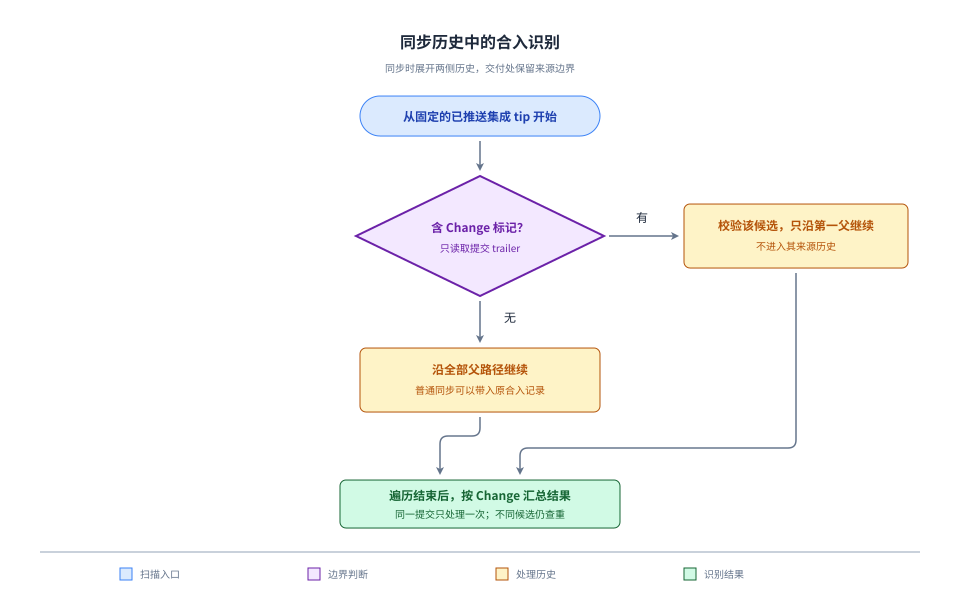

# 并发同步后保留有效合入识别

本方案落实 [Requirement](./requirement.md)，提交图与只读实验依据见 [Research](./research.md)。修复现有共用扫描器，不改变交付记录字段、差异比较接口或来源删除顺序。

## 扫描规则

从固定、已推送的集成 tip 开始，以第一父路径为基本扫描单位。遇到不含 `SpecTrail-Change` trailer 的合并时，把其他父提交加入待扫描集合；这样普通同步带入的另一段集成历史也会被读取。遇到含该 trailer 的提交时，把它作为声明的合入候选，沿第一父路径继续，不进入该候选的其他父路径。

Change 标记声明交付边界，第二父路径属于其来源历史。保留该边界，可避免把 PR 来源中的普通标记提交及内部合并误认成另一份集成交付。即使标记或候选无效，也对它诊断，不通过深入其来源历史补找一个成功记录。没有标记的普通提交不提供合入凭据。

仍按现有的 256 条上限分页读取第一父路径；待扫描集合和已处理提交集合只存在于本次扫描内。按提交身份去重，已处理的路径及时停止；同一提交从多条同步路径到达只处理一次，不使用递归，也不扫描仓库中无关分支。扫描只需要本地 Git 对象，不新增 GitHub API 请求或平台专用凭据。

这会把旧的“必须在当前 first-parent 主链中”改为“可以经普通同步合并的其他父路径到达，正式 Change 合入处仍排除来源路径”。恢复已有有效记录是本次有意调整的协议范围；不把全部祖先中任意一个带标记的提交直接认定为交付。

## 候选验证与结果

共用现有 `validator`：候选恰有两个父提交，具有唯一合法标记，只首次引入目标的有效归档，没有同 id 活动入口，且合并提交与第二父提交的完整归档子树一致。Git 原型仍须处于归档快照内。标题、正文提及和来源分支是否存在都不作为替代证据。

收集范围变化后，仍按 Change id 汇总：

| 情况 | 结果 |
| --- | --- |
| 唯一候选且原校验通过 | `found`，返回原合入提交 M、第一父 B、来源 S 及归档位置 |
| 没有候选 | `missing`，表示没有找到记录，不断言从未合入 |
| 不同候选重复声明同一 id，或候选校验不通过 | `invalid`，保留候选诊断，不任选其中一份 |
| 所需历史或对象无法读取 | `unavailable`；后续可重试，不冒充无记录或验证通过 |

同一个 M 通过多条路径到达不是重复候选。不同提交重复标记仍沿用现有拒绝规则，不新增自动择优或人工覆盖入口。单条候选的对象读取错误继续只影响对应 Change；遍历历史失败时整个索引保持不完整。

合入差异始终使用 `git diff M^1 M`；后续同步提交不替换 M。因此工作台显示的时间、来源、文件清单、原型与原交付一致。

## 共同调用与缓存

CLI 的验证、清理及归档返修、工作台交付判断与合入差异、Setup 的发布 PR 检查继续调用同一扫描器，不为各入口增加不同的兜底分支。

把 `INTEGRATION_VERSION` 递增到 2，复用服务端现有的索引版本判断。集成 tip 未变化时，版本 1 的完整索引也重新扫描；临时不可读记录按现有规则重试。已生成的旧快照继续保存其原始内容，新刷新生成使用新规则的快照；不修改用户数据、归档或历史提交，不增加迁移程序。

## 来源清理与同步指引

清理继续使用原 M 及其归档核对来源，保留所有既有保护：远端固定 tip 条件删除、新提交与祖先关系、其他活动或取消入口依赖、主工作区保护、工作区占用和文件状态。只有识别与实际交付验证均成功，才继续已授权的清理。代码和归档已合入、服务已部署、来源清理是否完成分别报告。

主工作区仍只安全快进。存在未推送本地提交且远端推进时，在独立工作区以最新远端集成为起点合入本地提交，普通推送后再快进主工作区，避免重置现场或改写已推送历史。该约定有助于保留远端主链，但识别正确性不再要求后续所有普通同步都维持原 M 的 first-parent 位置；现有 handoff 并发重试也可能产生这种同步结构。

实现与验证在本 Change 的独立分支完成。验收合入 `develop` 后更新长期服务并冒烟，再用新扫描器重新验证 `skill-auto-update` 的原 M。只有清理前提仍满足时才清理此前暂留的来源；有新提交、独有文件或占用时保留并报告具体原因。本轮方案阶段不使用临时实验替代正式合入校验或执行删除。

## 取舍核对

| 处理 | 机制与依据 |
| --- | --- |
| 保留 | 双亲、唯一标记、归档首次引入与子树一致性：证明可审计交付及删除依据，已有失败路径测试。 |
| 合并 | 在一个扫描器里处理普通同步路径、提交去重及候选校验；各调用方不添加独立恢复逻辑。 |
| 替换 | “只看当前第一父链”的候选查找，替换为上述有交付边界的路径遍历；当前真实图已证明旧条件会漏掉有效 M。 |
| 延后 | 自动同步引擎、PR API 反查与历史修复命令：本问题只需现有 Git 对象即可解决，不引入额外服务或权限。 |

## 验证

已有只读实验能在真实 tip 找回 `11a86db`，仍使用现有 `inspectIntegration` 验证为 `found`，且未进入其来源历史。临时仓库也验证了多层同步、多路径去重及来源普通标记排除；这些是遍历方向的可行性证据，完整结果与失败路径由正式实现测试覆盖。

正式回归覆盖原 first-parent 合入、并发同步及重复路径、候选歧义、来源内部标记和内部合并排除、无关分支排除、无效归档与不可读对象；在相同集成 tip 注入旧索引版本，验证重新扫描。CLI 验证/清理、工作台交付与固定差异、发布 PR 检查分别核对相同 M，保留来源删除与冷读取、以及新提交/脏文件/依赖保护回归。

整体验证包含相关集成测试、项目测试、skill 与 Setup 自包含测试、类型检查、格式检查和生产构建；medium 独立评审覆盖整个差异与需求。开发服务在验收合入后从主工作区构建更新，登录冒烟遵守 `withSmokeSession` 的独立会话及退出清理要求。
